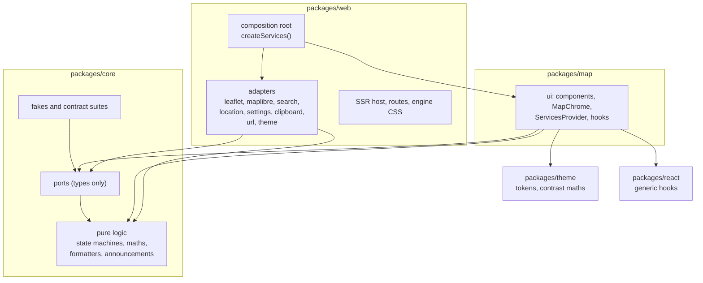

# Architecture

Karta separates what the app does from what it runs on. The interface and the pure logic depend on small interfaces (ports). Concrete code that touches a map engine, a browser API or a network service (adapters) lives in one place each and is wired together once, in the composition root.

## Layers and dependency rules

| Layer | Lives in | May import | Must not |
| --- | --- | --- | --- |
| core | `packages/core/src` | itself and npm maths libraries | touch DOM, React, a map engine, a browser global or the clock |
| ports | `packages/core/src/ports` | types from core | contain an implementation (apart from small typed error classes) |
| fakes | `packages/core/src/fakes` | ports, core | read browser globals |
| ui | `packages/map/src` | core, ports, theme, react | import an adapter, an engine or a browser service |
| adapters | `packages/web/src/adapters` | ports, core | be imported by anything except the composition root |
| composition root | `packages/web/src/composition` | everything | be imported as a singleton; it exposes `createServices()` only |

`npm run lint` enforces these rules with dependency-cruiser (layers, engine imports), Biome (restricted imports and globals, accessibility rules) and the harmony scanner in `scripts/harmony` (style, markup and wiring rules), whose rules are proven by Vitest tests in `packages/core/src/lint`. A violation fails the build.

## Ports

Add an interface only where a boundary has at least two implementations. Each port has a real adapter, a fake and a shared contract suite that runs against both.

| Port | Real adapter | Fake |
| --- | --- | --- |
| `MapAdapter` | Leaflet (raster), MapLibre GL JS (vector) | scripted in-memory map |
| `SearchProvider` | Nominatim | scripted results and errors |
| `LocationProvider` | browser geolocation | scripted fixes and errors |
| `SettingsStore` | `localStorage` with in-memory fallback | in-memory |
| `ClipboardPort` | `navigator.clipboard` with a legacy fallback | recording fake |
| `UrlState` | location hash and `history.replaceState` | in-memory |
| `ThemeSource` | `matchMedia` | scripted system preference |
| `LayerRegistry` | empty registry for now | list of sample layers |

`BasemapDefinition` is a typed data module, not a port. It is the only place that names a tile source, an attribution string or an engine.

Pure helpers (zoom conversion, metres per pixel, the surface state machine, sheet snapping, coordinate formatting, announcement text, theme resolution, hash parsing) are plain functions in core. They are not wrapped in interfaces.

## The map adapter

The ui never sees Leaflet or MapLibre. `MapView` asks the services for an adapter that suits the active basemap, mounts it in a host element and wires events to the rest of the ui.

- **Zoom** is normalised to the 256 px tile convention (Leaflet and OpenStreetMap numbering). MapLibre zoom is the normalised value minus one. The URL, the saved view, the scale bar and the tests use the normalised value only.
- **Capabilities** (`supportsRotation`, `supportsFeatureQuery`) replace engine checks. Leaflet has no rotation, so the compass never appears on it. The ui branches on capabilities, never on the engine name.
- **Overlays** (pin, measure line, accuracy circle) are drawn once, in a single overlay layer positioned with `adapter.project`, so they look the same on both engines.
- **Engine CSS** lives in one file, `packages/web/src/adapters/mapEngine.css.ts`. It hides engine controls, replaces fonts and focus rings, and sets the map background from the tokens.
- **Switching engines** unmounts one engine and mounts the other with the same centre, zoom and bearing. The chrome stays mounted.
- **Loading** is lazy. Each engine module imports its library dynamically the first time a basemap needs it.

## Adding an adapter

1. Define or extend the port in `packages/core/src/ports`, with typed errors and an `AbortSignal` on async calls.
2. Write the fake in `packages/core/src/fakes` and the contract suite in `packages/core/src/contracts`.
3. Write the real adapter in `packages/web/src/adapters`, passing the same suite.
4. Register it in `createServices()`.
5. Read it in the ui through a typed hook (`useSettings`, `useSearch` and so on).

## How tests substitute services

Unit tests wrap components in `ServicesProvider` with fakes. In non-production builds, `createServices()` accepts overrides from `window.__KARTA_TEST_SERVICES__`, set with Playwright `addInitScript`, so end-to-end tests script geolocation, search, clipboard, storage and the system theme. The seam is compiled out of production builds, and a test searches the build output to prove it.
