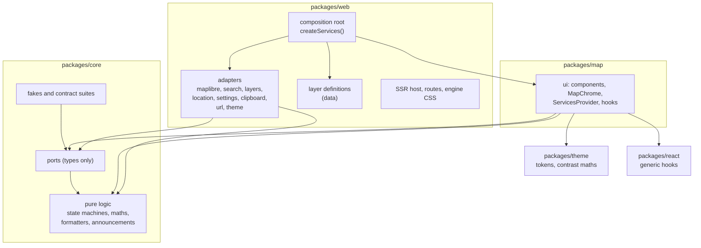

# Architecture

Karta separates what the app does from what it runs on. The interface and the pure logic depend on small interfaces (ports). Concrete code that touches a map engine, a browser API or a network service (adapters) lives in one place each and is wired together once, in the composition root.

## Layers and dependency rules

| Layer | Lives in | May import | Must not |
| --- | --- | --- | --- |
| core | `packages/core/src` | itself and npm maths libraries | touch DOM, React, a map engine, a browser global or the clock |
| ports | `packages/core/src/ports` | types from core | contain an implementation (apart from small typed error classes) |
| fakes | `packages/core/src/fakes` | ports, core | read browser globals |
| ui | `packages/map/src` | core, ports, theme, react | import an adapter, an engine or a browser service |
| adapters | `packages/web/src/adapters` | ports, core | be imported by anything except the composition root |
| composition root | `packages/web/src/composition` | everything | be imported as a singleton; it exposes `createServices()` only |

`npm run lint` enforces these rules with dependency-cruiser (layers, engine imports), Biome (restricted imports and globals, accessibility rules) and the harmony scanner in `scripts/harmony` (style, markup and wiring rules), whose rules are proven by Vitest tests in `packages/core/src/lint`. A violation fails the build.

## Ports

Add an interface only where a boundary has at least two implementations. The fake counts as the second implementation. Each port has a real adapter, a fake and a shared contract suite that runs against both.

`MapAdapter` has one real implementation, MapLibre GL JS, and is kept for two reasons. It is the boundary between the ui and the engine, so the ui never imports `maplibre-gl`. It also lets unit tests run the ui against an in-memory fake, with no WebGL. The contract suite runs against the fake and against the real `MapLibreMapAdapter` code, but the adapter there drives a hand-written stand-in for the MapLibre map (`FakeMapLibreMap` in `packages/web/src/adapters/maplibre/maplibreTestEngine.ts`), not `maplibre-gl` itself, because unit tests have no WebGL. The suite keeps the two adapters in step with each other; it does not prove the stand-in matches MapLibre. The end-to-end tests are what exercise the real engine.

| Port | Real adapter | Fake |
| --- | --- | --- |
| `MapAdapter` | MapLibre GL JS (vector and raster styles) | scripted in-memory map |
| `SearchProvider` | Nominatim | scripted results and errors |
| `LocationProvider` | browser geolocation | scripted fixes and errors |
| `SettingsStore` | `localStorage` with in-memory fallback | in-memory |
| `DevicePreferences` | `matchMedia` (reduced motion, fine pointer) and `navigator.connection` (save data, where the browser has it) | scripted values |
| `ClipboardPort` | `navigator.clipboard` with a legacy fallback | recording fake |
| `UrlState` | location hash and `history.replaceState` | in-memory |
| `ThemeSource` | `matchMedia` | scripted system preference |
| `LayerRegistry` | the host's definitions, validated at start-up (`createLayerRegistry`) | `StaticLayerRegistry` over sample definitions |
| `LayerSource` | `FetchLayerSource` (`fetch`, shared response cache) | `FakeLayerSource`, scripted per layer id |
| `RoutingProvider` (optional) | none shipped; a host supplies one | `FakeRoutingProvider`, scripted routes, areas, errors and delays |

`BasemapDefinition` is a typed data module, not a port. It is the only place that names a tile source or an attribution string. A `raster` source is a tile URL template and a tile size, and a `vector` source is a style URL. `DEFAULT_BASEMAP_ID` (Liberty) is the basemap in both themes when nothing is saved or linked, and an unknown id, including the "auto" and the removed "dark" of earlier versions, resolves to it. `DEFAULT_BASEMAP_BACKGROUND` is its land colour; the `mapBackground` token carries the same value (a test in `packages/web` keeps them equal), so the server-rendered placeholder and the map host match Liberty before it draws. The placeholder also holds the decorative `ChromeSkeleton`, so the chrome is in its final place on the first paint.

`RoutingProvider` is the one optional service: `Services.routing` may be absent, and the ui must work without it. `route({ stops, mode, signal })` returns one GeoJSON line feature for each leg with its distance (metres) and duration (seconds), and `reachableArea({ origin, minutes, mode, signal })` returns polygon features. Both reject only with a typed `RoutingError` (`network`, `invalid`, `no-route`, `rate-limited`, `aborted`, `unsupported`).

Pure helpers (layer templates, decoders and style evaluation, zoom conversion, metres per pixel, the surface state machine, sheet snapping, coordinate formatting, announcement text, theme resolution, hash parsing) are plain functions in core. They are not wrapped in interfaces.

## The map adapter

MapLibre GL JS is the only map engine, and the ui never imports it. `MapView` takes an adapter factory (`() => MapAdapter`) from the services, mounts one adapter in a host element and wires events to the rest of the ui. Changing basemap calls `setBasemap` on that adapter, with the Save data mode (`useSaveData`: the stored choice, else the device preference), so the adapter can leave out the layers the basemap's `saveDataOmitLayers` lists. It removes those layers, and any source only they use, in its `style.load` handler, before data layers are drawn again, so a Save data change never loses them. It avoids `transformStyle` because a swap with it set waits for the current style, so a failed swap could not put the last basemap back. The adapter builds an inline raster style for a `raster` source and loads the style URL for a `vector` source.

- **Zoom** is normalised to the 256 px tile convention (OpenStreetMap tile numbering). MapLibre counts 512 px tiles, so the engine zoom is the normalised zoom minus one. That offset is one constant, converted only inside the adapter. For the 256 px raster style, the tile level equals the normalised zoom. The URL, the saved view, the scale bar and the tests use the normalised value only.
- **Overlays** (pin, measure line, accuracy circle, the selected feature's ring) are drawn once, in a single overlay layer positioned with `adapter.project`.
- **Data layers** are the exception, because hundreds of points or a tiled image belong in the engine. `setFeatureLayer` draws points whose colour, size and shape the ui has already worked out, `setTileLayer` draws raster or WMS tiles (`{bbox-epsg-3857}` is filled by MapLibre) and changes opacity in place, `setShapeLayer` draws an affected area, and `removeLayer` removes any of them. They stack tiles, then shapes, then points, above the basemap, may be set before mount, and are drawn again after every `style.load`, because a full style swap drops them. Points are symbols whose images are rasterised in `markerImages.ts`, so squares and triangles carry meaning beside colour. A tap within a fingertip of a point emits `featureTap` before `click`.
- **Engine CSS** lives in one file, `packages/web/src/adapters/mapEngine.css.ts`. It styles MapLibre only, scopes its rules under the host's `data-map-host` attribute, hides MapLibre's own controls, replaces fonts and focus rings, and sets the map background from the tokens.
- **Loading** is lazy. The MapLibre module imports `maplibre-gl` dynamically the first time the map mounts.
- **User zoom.** The adapter emits `userZoom` only for zoom gestures the engine handles (wheel, pinch, double-click), which MapLibre marks with the input event. `MapView` adds the zoom keys and exposes both as `onUserZoom`, so the app announces the settled level after every zoom the person makes and never after one made in code.
- **Failures.** Tile and source failures are `tileError`, and the map keeps working. A source-less error before the pending style document has loaded (`style.load`) is that document failing, and rejects the mount or basemap swap; a sprite or glyph failure comes after it and is a `tileError`. A failed swap puts the last basemap that loaded back, so the map keeps working: `MapView` reports it through `onBasemapError`, not as an engine error, and the app saves a basemap choice only once it has loaded, then shows "That basemap could not be loaded." with "Use previous basemap". MapLibre reports every worker `error` event with one message, whether the worker never started or threw while running, so after load the adapter waits up to five seconds: if the map goes idle or has everything loaded, it is a `tileError`; otherwise `fatalError` (reason `stopped`), and the app shows "The map stopped working" with Reload, as an alert. A worker error during the first load rejects the mount. A missing WebGL2 context is recognised by MapLibre's exported `GPUInitializationError`.
- **No WebGL** means no map. There is no fallback basemap. The app shows a plain message in place of the map ("Karta needs WebGL to draw the map.") with advice to try a different browser or turn on hardware acceleration. `MapUnavailable` draws it inside the map region, so the region and the skip link still work, and announces it once, assertively, through the shared announcer rather than being a live region itself. It has no Retry, because mounting again would fail the same way.

## Data layers

Plan 0001 makes a data layer typed data: a `LayerDefinition` in `packages/web/src/layers/definitions/`, one file each, collected with `import.meta.glob`. Nothing in the code branches on a layer id, a provider or a response shape.

- **Core** (`packages/core/src/layers`) holds the definition types and a hand-written schema check (`validateLayerDefinition`; core stays free of schema libraries), URL and card templates (`{window}`, `{time|relative}`; the engine's `{z}`, `{x}`, `{y}` and `{bbox-epsg-3857}` are left alone), derived URL variables looked up from control values, filters, a decoder registry with the built-in `geojson` decoder (fields mapped by dotted path, so USGS and GDACS share it), a formatter registry (`relative`, `number`, `km`, `date`), style evaluation with a legend derived from the style, palette slot names, and `SharedResponseCache`, which reuses a response for its `max-age` (or the definition's `cacheSeconds`) and shares a request in flight, so layers split from one feed cost one request.
- **The `LayerSource` port** loads any feed definition with `load({ definition, controls, now, signal })` and an on-request `loadDetail`, and rejects only with a typed `LayerError` (`network`, `invalid`, `empty`, `aborted`). A detail URL comes from the provider's data, so it is requested only when it is `https` on an origin the definition declares.
- **Map** (`packages/map/src/layers`) has `useDataLayers` (state, loading, cancellation, announcements, the permalink value), `MapDataLayers` (draws through the adapter, turns taps into selections), `SelectionMarker`, and the generic `LayersSection`, card and list. The data palette values live in `@karta/theme` (`tokenValues.dataPalette`).
- **Web** registers the definitions and `FetchLayerSource` in `createServices()`. A loop test (`src/layers/layers.test.ts`) checks every definition against the schema, the production CSP, `ATTRIBUTIONS.md` and a recorded fixture, and names what is missing.
- **Permalink.** `UrlStateValue.layers` is written as `#layers=earthquakes,imagery&earthquakes.window=day`, together with the view, so neither drops the other. Values are resolved against the definition when read, so a hand-edited link cannot reach an unknown control or value.

## Adding an adapter

1. Define or extend the port in `packages/core/src/ports`, with typed errors and an `AbortSignal` on async calls.
2. Write the fake in `packages/core/src/fakes` and the contract suite in `packages/core/src/contracts`.
3. Write the real adapter in `packages/web/src/adapters`, passing the same suite. Helpers that more than one adapter uses (the event emitter, reading media queries) live in `packages/web/src/adapters/shared`.
4. Register it in `createServices()`.
5. Read it in the ui through a typed hook (`useSettings`, `useSearch` and so on).

## How tests substitute services

Unit tests wrap components in `ServicesProvider` with fakes. In non-production builds, `createServices()` accepts overrides from `window.__KARTA_TEST_SERVICES__`, set with Playwright `addInitScript`, so end-to-end tests script geolocation, search, clipboard, storage and the system theme. Layer providers are answered from the committed fixtures with `page.route` (`e2e/support/layers.ts`), so the e2e tests exercise the real fetch source and decoders. The seam is compiled out of production builds, and a test searches the build output to prove it.
