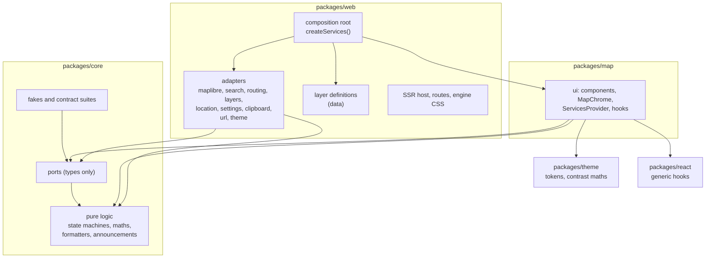

# Architecture

MapCairn separates what the app does from what it runs on. The interface and the pure logic depend on small interfaces (ports). Concrete code that touches a map engine, a browser API or a network service (adapters) lives in one place each and is wired together once, in the composition root.

## Layers and dependency rules

| Layer | Lives in | May import | Must not |
| --- | --- | --- | --- |
| core | `packages/core/src` | itself and npm maths libraries | touch DOM, React, a map engine, a browser global or the clock |
| ports | `packages/core/src/ports` | types from core | contain an implementation (apart from small typed error classes) |
| fakes | `packages/core/src/fakes` | ports, core | read browser globals |
| ui | `packages/map/src` | core, ports, theme, react | import an adapter, an engine or a browser service |
| adapters | `packages/web/src/adapters` | ports, core | be imported by anything except the composition root |
| composition root | `packages/web/src/composition` | everything | be imported as a singleton; it exposes `createServices()` only |

`npm run lint` enforces these rules with dependency-cruiser (layers, engine imports), Biome (restricted imports and globals, accessibility rules) and the harmony scanner in `scripts/harmony` (style, markup and wiring rules), whose rules are proven by Vitest tests in `packages/core/src/lint`. A violation fails the build.

## Ports

Add an interface only where a boundary has at least two implementations. The fake counts as the second implementation. Each port has a real adapter, a fake and a shared contract suite that runs against both, apart from `FeatureSelection`, whose one class is the SDK's store and its fake together, and `FeatureQuery`, which has no adapter in this repository: a host that supplies one runs the contract suite against it.

`MapAdapter` has one real implementation, MapLibre GL JS, and is kept for two reasons. It is the boundary between the ui and the engine, so the ui never imports `maplibre-gl`. It also lets unit tests run the ui against an in-memory fake, with no WebGL. The contract suite runs against the fake and against the real `MapLibreMapAdapter` code, but the adapter there drives a hand-written stand-in for the MapLibre map (`FakeMapLibreMap` in `packages/web/src/adapters/maplibre/maplibreTestEngine.ts`), not `maplibre-gl` itself, because unit tests have no WebGL. The suite keeps the two adapters in step with each other; it does not prove the stand-in matches MapLibre. The end-to-end tests are what exercise the real engine.

| Port | Real adapter | Fake |
| --- | --- | --- |
| `MapAdapter` | MapLibre GL JS (vector and raster styles) | scripted in-memory map |
| `SearchProvider` | Nominatim | scripted results and errors |
| `SuggestionProvider` (optional) | `PhotonSuggestionProvider`, the reference host's one adapter, for the public Photon server; the SDK ships none | `FakeSuggestionProvider`, scripted suggestions, errors and holds |
| `LocationProvider` | browser geolocation | scripted fixes and errors |
| `SettingsStore` | `localStorage` with in-memory fallback | in-memory |
| `DevicePreferences` | `matchMedia` (reduced motion, fine pointer) and `navigator.connection` (save data, where the browser has it) | scripted values |
| `ClipboardPort` | `navigator.clipboard` with a legacy fallback | recording fake |
| `FileSaver` | `Blob`, an object URL and a download link | recording fake |
| `FileOpener` (optional) | `BrowserFileOpener`: a hidden `<input type="file">`, read with `File.text()` | `FakeFileOpener`, a scripted picker (choose, cancel, fail) |
| `UrlState` | location hash and `history.replaceState`; `link(value)` builds an address without writing it | in-memory |
| `ThemeSource` | `matchMedia` | scripted system preference |
| `LayerCatalogue` | `createStaticLayerCatalogue` over the host's definitions, validated at start-up and ready on the first render (the reference host); `createRuntimeLayerCatalogue` for a host that loads them with its own function | `FakeLayerCatalogue`, scripted with `setLayers` and `setState` |
| `LayerSource` | `FetchLayerSource` (`fetch`; feeds go through a shared response cache, an identify never does) | `FakeLayerSource`, scripted per layer id, with its identify scripted apart from its loads |
| `RoutingProvider` (optional) | `ValhallaRoutingProvider`, the reference host's one adapter, for a public Valhalla server; the SDK ships none | `FakeRoutingProvider`, scripted routes, areas, errors and delays |
| `FeatureSelection` (optional) | `MemoryFeatureSelection` keeps the set in memory; the reference host builds no store, so a host that wants selection supplies one, which may keep the set on a server | `MemoryFeatureSelection`, the same class, scripted with `replaceExternally` |
| `FeatureQuery` (optional) | none: the SDK and the reference host ship no query, so a host that offers selection by shape supplies one, which may ask a server | `FakeFeatureQuery`, scripted with `respondWith`, `failWith` and `hold` |

The settings keys are `mapcairn:<name>`.

**The layer catalogue.** `LayerCatalogue` (`packages/core/src/ports/layers.ts`) is a port, unlike the plain-data `BasemapCatalogue` described below: its state changes while the app runs, so it has `getState()`, `subscribe(listener)` and `refresh()`, and it has three implementations (static, runtime and the fake) that share one contract suite, `contracts/layerCatalogue.contract.ts`. The state is `loading`, `failed` (`network` or `invalid`) or `ready`; `ready` carries the layers, the definitions that were skipped with their problems, and a refresh state (`idle`, `loading` or `failed`). A catalogue with no layers is `ready` with none, and a failed refresh keeps the last list. `getState()` returns the same object until something changes and is also the server snapshot, so `useDataLayers` reads the catalogue with `useSyncExternalStore`, and no method uses `this`, so `getState` and `subscribe` can be passed on alone. `refresh()` never rejects: a failure is the state.

- `createStaticLayerCatalogue(definitions, options)` is ready from the first read, on the server too, never changes, and still throws at start-up on any invalid definition or duplicate id, which suits definitions in the build.
- `createRuntimeLayerCatalogue({ load, options, onSkipped })` takes the host's `load(signal)`, so the host owns the endpoint and any credentials and the SDK fetches nothing. It is `loading` when built and on the server. It calls `load` on the first subscription (or the first `refresh()`) and only once for that, so React's StrictMode, which subscribes, unsubscribes and subscribes again, makes one request. One request is in flight at a time, and a second `refresh()` gets the pending promise. The signal is aborted only by `dispose()`, which is for the host's teardown, and a result that arrives after it is ignored. It loads again only when the host calls `refresh()`; it has no timer.
- `partitionDefinitions(raw, options, previous)` is how the runtime catalogue keeps one bad definition from costing the list. It validates each value with `validateLayerDefinition`, skips a non-object (with no id) and a definition whose id an earlier valid one already has (the first wins), and does not throw whatever an entry holds: an entry that cannot be read at all is skipped with the problem `definition: could not be read`. A definition that is deeply equal to the previous one with the same id keeps the previous object, and an unchanged list keeps the previous array, so a refresh that changes nothing changes no reference. The comparison follows at most `MAX_JSON_DEPTH` (100) levels and counts anything deeper as changed. The runtime catalogue also treats a payload that cannot be read as `invalid`, so a server cannot make `refresh()` reject or leave the state loading.

The Layers section shows the layers of a `ready` catalogue and says what the catalogue is doing besides holding layers. `useDataLayers` returns `catalogue` (the `status`, the `skipped` count, the `refresh` state, and `awaited`, which is true when the catalogue was not ready at mount) and `retryCatalogue()`, which calls `refresh()` only after a failed load or a failed refresh. While the catalogue is `loading` the section says "Loading layers" and is `aria-busy`, and a runtime catalogue renders that on the server too. After a failed load it says "Layers could not be loaded." with a Try again button. A `ready` list with no layers says "No layers are available." only when `awaited`: a host whose first state was `ready` and empty has no Layers section. Skipped definitions read "1 layer could not be shown" or "3 layers could not be shown". A failed refresh keeps the last list and says "Layers could not be updated. Showing the last list." with Try again, which is not said while the section is hidden. There is no general refresh button, and a refresh the host starts shows nothing while it loads. Try again stays in place, busy, while it retries, so focus stays on it; when the catalogue recovers and the button has gone, focus moves to the section heading if the button had focus or had just been pressed, and the person has not moved it elsewhere. A retry is one that has been seen loading and has stopped, so a catalogue that publishes `loading` after `refresh()` returns is handled too. The line above the layers is the `intro` prop of `LayersSection` and `SheetContent`, which defaults to "Open data from public providers. Nothing is requested until you turn a layer on." and which a host behind a login replaces. What each transition says aloud is under "Data layers". The status lines are plain text, not a live region (`packages/map/src/layers/CatalogueStatus.tsx`). The reference site uses the static catalogue, which is ready on the first render, so it shows none of these states.

`BasemapDefinition` is a typed data module, not a port. It is the only place that names a tile source or an attribution string. A `raster` source is a tile URL template and a tile size, a `vector` source is a style URL, and a `hybrid` source is image tiles (a tile URL template, a tile size and `maxTileZoom`, the deepest level with real detail) under the line and symbol layers of a label style (`labelStyleUrl`) that draw from the source layers it names (`labelSourceLayers`), less any layer it names to leave out (`labelOmitLayers`, such as ferry routes). `usesMoreData` (core) is true for a raster or hybrid basemap, and the picker's Save data note reads it. A definition may set `nonCommercial` when its provider's licence allows only non-commercial use; the SDK's own list holds none, which a test in core checks, together with an allow-list of the SDK's source origins. `DEFAULT_BASEMAP_ID` (Bright) is the basemap in both themes when nothing is saved or linked, and an unknown id, including the "auto" of earlier versions, resolves to it. `DEFAULT_BASEMAP_BACKGROUND` is its land colour; the `mapBackground` token carries the same value (a test in `packages/web` keeps them equal), so the server-rendered placeholder and the map host match Bright before it draws. The reference host offers four of the SDK's seven basemaps and two of its own (see below), so there a saved or linked `liberty` opens on the default. The placeholder also holds the decorative `ChromeSkeleton`, so the chrome is in its final place on the first paint.

**Host-supplied basemaps.** The SDK ships only the built-in basemaps (`BASEMAPS`). A host that wants another builds a `BasemapCatalogue` with `createBasemapCatalogue(basemaps, defaultId)` and passes it as the optional `Services.basemaps`; without it the ui offers the built-in catalogue (`BUILT_IN_BASEMAP_CATALOGUE`, Bright the default). The catalogue is plain data with `get(id)` and `resolve(id)`, not a port: it has one shape and no second implementation, so it has no fake and no contract suite, and `portRegistry` lists it under `DATA_SERVICE_NAMES` beside the ports. The picker (`BasemapPicker`), the saved-or-linked choice (`useBasemapChoice`) and the default all read it through `useBasemaps()`, and an id the catalogue does not hold, such as the retired "maptoolkit-dark", resolves to its default. A provider whose licence the host accepts, and that the reusable SDK packages must not carry, is defined in the host and added to a catalogue the host builds. The reference host adds two, Topographic and Satellite, and it does not offer the whole built-in list either: `packages/web/src/basemaps/hostBasemaps.ts` builds the host's catalogue from a subset of `BASEMAPS` with `getBasemap`, the host's own definitions from `packages/web/src/basemaps/openTopoMapBasemap.ts` and `satelliteBasemap.ts`, and `createBasemapCatalogue` (copies of the SDK's definitions, with the host's preview path added), and `createServices()` passes it. It holds Bright (the default), Positron, Streets, Topographic (OpenTopoMap, defined by the host, not the SDK), Satellite (EOX Sentinel-2 cloudless imagery under OpenFreeMap Bright's place names, roads and borders, defined by the host) and Dark (`appearance: "dark"`, a manual choice that never follows the theme), in that order. OpenTopoMap is a volunteer-run server whose terms ask for light use and a note about it, so the SDK does not send every app built on it there; the host takes that on, and its definition imports types only so the thumbnail script can load it (its preview is in `BASEMAP_THUMBNAILS`, as every basemap's is). Satellite's imagery is under CC BY-NC-SA 4.0, a non-commercial licence the reusable SDK must never carry, so the host defines it with `nonCommercial: true`; EOX's tiles come from a free demo service with no guarantee and rate limits, which basemap-unavailable detection covers. Its definition imports types only too. The other four ask for no more than their credit text. Liberty, Colorful and Fiord stay in the SDK for other hosts, and the site makes no request to the VersaTiles server that Colorful uses. A saved or linked id the catalogue does not hold, such as `liberty` or the retired `maptoolkit-dark`, opens on the default. The WebMCP `set-map-basemap` tool offers the basemaps of the host's catalogue (`useBasemaps()`), so it never offers one the picker does not show; a basemap marked `nonCommercial` is left out (`basemapChoices`), because an agent should not accept a provider's licence on a person's behalf, so the tool offers five of the reference host's six. In the e2e build only, the browser test seam can replace the catalogue, so a spec can run on a host that offers the SDK's whole list.

A definition's `thumbnail` is optional, and it is a root-relative path the host serves; if the image fails to load, the picker shows the swatch. A basemap without one shows the picker's plain swatch, as Save data does, because only a host that serves the files, and has the right to them, can offer a preview; so does a tile whose image fails to load. The SDK's own definitions name no preview, so a host that serves none (the example app, say) shows a swatch for every SDK basemap and never requests an image, and a test in `core` and one in `map` check both. The reference host adds its previews as data: `BASEMAP_THUMBNAILS` in `packages/web/src/basemaps/basemapThumbnails.ts` maps each basemap it offers to a file in `packages/web/public/basemaps`, `hostBasemaps.ts` sets `thumbnail` on a copy of each definition it offers, and a test in `packages/web` checks that every basemap the host offers has its file. The thumbnail script reads the same table. A host that wants another place for its files only changes the paths in its own table, so the SDK carries no base URL.

`RoutingProvider`, `FileOpener`, `SuggestionProvider`, `FeatureSelection` and `FeatureQuery` are the optional services: `Services.routing`, `Services.fileOpener`, `Services.suggestions`, `Services.selection` and `Services.featureQuery` may be absent, and the ui must work without them. Without a file opener the Shapes section has no Import control. `route({ stops, mode, signal })` returns one GeoJSON line feature for each leg with its distance (metres) and duration (seconds), and `reachableArea({ origin, minutes, mode, signal })` returns polygon features. Both reject only with a typed `RoutingError` (`network`, `invalid`, `no-route`, `rate-limited`, `aborted`, `unsupported`).

The reference host's `ValhallaRoutingProvider` (`packages/web/src/adapters/routing`) calls a public Valhalla server with `GET /route` and `GET /isochrone`, decodes the encoded polyline shape itself, maps HTTP and network failures to those kinds, starts at most one request a second through the shared `RequestSpacer`, and sends no cookies or referrer. `packages/map` holds only the generic Directions tool (`tools/Directions`): `useDirections` keeps the stops, mode and result and cancels superseded requests, `DirectionsPanel` is the interface, `MapDirections` draws the result through `setShapeLayer` and fits the map clear of the sheet, and `DirectionsOverlay` draws the lettered stops. None of them names a provider; the host passes the credit and the privacy note, and mounts the button only when `services.routing` exists.

**Search suggestions.** `Services.suggestions` is an optional `SuggestionProvider` (`suggest(query, { limit, signal })`, resolving `SearchResult`s, so a suggestion carries its centre and optional extent and picking one needs no second lookup). It is a port of its own, apart from `SearchProvider`, because the two services have different terms: Nominatim's usage policy forbids a request on every keystroke, and a service built for typing makes different promises. A host without it keeps submit-only search; nothing else changes. The adapter rejects only with `SearchError` (`offline`, `rate-limited`, `failed`, where a timeout is `failed`) or `PortAbortError`. The reference host's `PhotonSuggestionProvider` (`packages/web/src/adapters/search`) calls `GET /api/?q&limit&lang=en` on the public Photon server (run by komoot on OpenStreetMap data), reads its GeoJSON (the centre is longitude then latitude, the extent west, north, east, south), starts at most one request every 250 ms through `RequestSpacer`, fails a request after four seconds, and sends no position, no cookies and no referrer. Everything that decides when to ask lives in one hook, `useSuggestions` in `packages/map/src/tools/SearchPill`: it waits for a pause in typing (`SUGGEST_DEBOUNCE_MS`, 275 ms), asks only for at least `MIN_SUGGEST_LENGTH` (3) characters that include a word of three or more letters, so a coordinate pair is never sent, not even while it is being typed, aborts the request before it whenever the text changes so an older answer is never shown, and announces the count politely. After `SUGGEST_FAILURE_LIMIT` (3) failures in a row, or one `rate-limited` answer, it stops asking for `SUGGEST_COOLDOWN_MS` (60 s) and announces once that suggestions are unavailable and Enter still searches. `SearchPill` shows the suggestions in its one listbox (named "Suggestions" until a search is submitted, then "Search results"), so a suggestion is an option exactly like a result, picked by the same keys and taps, and Enter with none highlighted still submits to Nominatim. The public Photon server states only that clients should be fair and gives no terms for commercial use, so a commercial host runs its own Photon server and passes it as the adapter's `endpoint` (see `docs/guides/extending.md`).

The other copy that names a provider works the same way. The Settings privacy statement (`privacyNote` on `SheetContent` and `SettingsSection`) and the note under the pin card's "Look up address" (`lookupNote` on `PinCard`) are props that take text or nodes, and each has a neutral default that names no provider. The reference host supplies its own in `packages/web/src/constants/providerNotes.ts`, so its visible text is the same as the privacy page and `PRIVACY.md` describe, and an embedding host writes its own.

Pure helpers (layer templates, decoders and style evaluation, zoom conversion, metres per pixel, the surface state machine, sheet snapping, coordinate formatting, announcement text, theme resolution, hash parsing) are plain functions in core. They are not wrapped in interfaces.

**The feature selection.** `FeatureSelection` (`packages/core/src/ports/selection.ts`) is the set of features a person has picked. Each `FeatureRef` is a layer id and a feature id, the pair a tap reports (`MapFeatureHit`). The store is synchronous (`getState()`, `subscribe(listener)`, `add`, `remove`, `replace`, `clear` and a `limit`), because `useSyncExternalStore` needs a snapshot of stable identity, so it has no loading or failed state. A host that saves the set somewhere slow keeps a local copy, writes behind it, and calls its subscribers when the copy changes, when it hydrates or when it restores the copy after a failed save. The rules for every implementation are in `contracts/featureSelection.contract.ts`:

- `getState()` returns the same array until a change, in selection order, and `getState` and `subscribe` work when taken off the object.
- A duplicate is ignored, and a call that changes the set tells every subscriber once, while a call that changes nothing tells none.
- A call that would take the total past `limit` changes nothing, so a batch is refused whole, as a shape file that would take the drawing past `MAX_DRAWING_SHAPES` is. The refusal is silent and the methods return nothing, so a caller compares `getState()` before and after to tell it from a batch of duplicates.
- A store that hydrates with more than `limit` references shows them all and refuses every addition. Removing is always allowed.

`MemoryFeatureSelection` is the one class the SDK ships, as `MemorySettingsStore` is for settings: it is the store and its fake. Its limit defaults to `DEFAULT_SELECTION_LIMIT` (200), and `replaceExternally(refs)` scripts a change from outside, such as hydration or a failed save. `Services.selection` is optional and `createServices()` builds none (`HOST_SUPPLIED_PORT_NAMES` in `contracts/portRegistry.ts`), so the reference site offers no selection and a host that wants it supplies a store. `featureRefKey(ref)` (`ports/selection.ts`) is the one key for a set or map of references, which the memory store and the ui both use, so they cannot disagree on which references are the same. `useSelectionStore()` returns it. `useFeatureSelection` reads it for the ui (see "Data layers"), and the reference host and the example app call that hook. The highlights, the panel and select mode are planned in [`docs/plans/0007-multi-feature-selection.md`](docs/plans/0007-multi-feature-selection.md) and are not built. The set is not written to the permalink.

**The feature query.** `FeatureQuery` (`packages/core/src/ports/featureQuery.ts`) answers "which features lie inside this area", so the synchronous selection store never waits on it. `within({ area, layerIds, limit, signal })` resolves `SelectionHit`s, each a layer id and the `LayerFeature` itself, so the caller can show it without loading its layer. The `area` is a `QueryArea` polygon, and the polygon `shapeGeometry` gives for a drawn polygon or circle passes as it is. A caller that has room for `n` more asks for a `limit` of `n + 1`, so a result of that size tells it that more lie inside, and the host can stop looking once it has them. The rules for every implementation are in `contracts/featureQuery.contract.ts`: hits only from the layers named, a feature once, exactly `limit` hits when at least that many lie inside, no hits for no layers, and a rejection only with a typed `FeatureQueryError` (`network`, `invalid`, `unsupported`, `aborted`). `invalid` covers a `limit` that is not a whole number of at least 1 and an area that is not a polygon with at least one closed ring on the globe. The port does not check that a hole lies inside the outer ring, that no edge crosses another or how large a ring is, so a host guards against a very large ring itself. `Services.featureQuery` is optional and `createServices()` builds none (`HOST_SUPPLIED_PORT_NAMES`): the SDK ships no query and sends nothing itself, so a host whose query sends a shape to a server tells its visitors. `FakeFeatureQuery` is scripted with `respondWith`, `failWith` and `hold`, and `useFeatureQuery()` returns the port. Nothing in the ui reads it yet: the Shapes section's action to select the features inside a shape is planned in the same plan and is not built.

## The map adapter

MapLibre GL JS is the only map engine, and the ui never imports it. `MapView` takes an adapter factory (`() => MapAdapter`) from the services, mounts one adapter in a host element and wires events to the rest of the ui. Changing basemap calls `setBasemap` on that adapter, with the Save data mode (`useSaveData`: the stored choice, else the device preference), so the adapter can leave out the layers the basemap's `saveDataOmitLayers` lists. It removes those layers, and any source only they use, in its `style.load` handler, before data layers are drawn again, so a Save data change never loses them. It avoids `transformStyle` because a swap with it set waits for the current style, so a failed swap could not put the last basemap back. The adapter builds an inline raster style for a `raster` source and loads the style URL for a `vector` source. For a `hybrid` source it loads the label style and, in its `style.load` handler, before Save data and data layers, keeps only the line and symbol layers that draw from one of `labelSourceLayers`, less those in `labelOmitLayers`, so no area of the style (land, water, buildings, road areas) covers the imagery, and removes any source only the removed layers used. It then adds the imagery as a raster source capped at `maxTileZoom` and a layer under the rest, so MapLibre enlarges the deepest real level instead of asking for more, and under that a background layer in the basemap's `swatch` colour, so a dark basemap is not pale before its imagery draws. If that fails, a pending mount or swap fails with it, so a swap puts the last basemap back. No code names a basemap.

- **Zoom** is normalised to the 256 px tile convention (OpenStreetMap tile numbering). MapLibre counts 512 px tiles, so the engine zoom is the normalised zoom minus one. That offset is one constant, converted only inside the adapter. For the 256 px raster style, the tile level equals the normalised zoom. The URL, the saved view, the scale bar, the zoom level in the readout and the tests use the normalised value only.
- **Overlays** (pin, measure line, accuracy circle, the open card's ring) are drawn once, in a single overlay layer positioned with `adapter.project` and hidden with `adapter.isVisible` when they are on the far side of a globe. The pin, the measure line, drawn shapes, handles and directions stops are placed through `placePoint` and `placePath` in core (`packages/core/src/globe`), described under Flat or globe.
- **Data layers** are the exception, because hundreds of points or a tiled image belong in the engine. `setFeatureLayer` draws points whose colour, size and shape the ui has already worked out, `setTileLayer` draws raster or WMS tiles (`{bbox-epsg-3857}` is filled by MapLibre), requests no tile wholly outside the definition's optional `bounds` (`[west, south, east, north]`, west less than east; a tile that straddles an edge is still drawn whole), and changes opacity in place, `setShapeLayer` draws an affected area, and `removeLayer` removes any of them. They stack tiles, then shapes, then points, above the basemap, may be set before mount, and are drawn again after every `style.load`, because a full style swap drops them. Points are symbols whose images are rasterised in `markerImages.ts`, so squares and triangles carry meaning beside colour. A tap within a fingertip of a point emits `featureTap` before `click`.
- **Styled shapes, vector tiles and heatmaps.** `setStyledShapes` draws polygons or lines whose look (colour, opacity, hatching, dash and width) the ui has already worked out per shape, and optional label text. `setVectorLayer` draws vector tiles whose features the ui never sees, so the port carries a rule (`fixed`, `category` or `steps` over one property) that the adapter compiles to engine expressions, with a zoom window for the layer and for each source layer. `setHeatmapLayer` draws point density from loaded points or from a vector source layer. Layer windows are normalised zoom, converted inside the adapter; a source's `minzoom` and `maxzoom` are tile levels and are passed through. One data layer owns several engine layers (a fill, a hatching layer, outlines per dash, labels), and the adapter keeps their ids so it erases and orders them as a unit. Hatching is a data-driven `fill-pattern` over images rasterised in `patternImages.ts`; dashes cannot be data-driven, so there is one engine layer per dash style, filtered by value. Labels need glyphs, so they are drawn only when the basemap's style has a glyph source and a literal font stack; a raster basemap has neither, and the list, card and legend carry the words there. Stacking, lowest first: tiles, vector tiles, styled shapes, affected areas, heatmaps, points.
- **Hits and bounds.** `featuresAt(point)` lists every tappable feature under a pixel, topmost first and once each (points and lines within a fingertip, polygons exactly), and `featureTap` carries the topmost one together with that list in `hits`. `getBounds()` is the box the map shows. Vector tile features and heatmaps are not tappable.
- **Image export.** `toImage(options)` returns a PNG blob. The adapter hands the work to `MapImageExporter` in `imageExport.ts`, which keeps only the queue of requested exports (below) and reads seven things from the adapter through `MapImageExportHost`: the mounted map (none before `mount` or after `destroy`), whether a basemap swap is pending, the overlay placement on a given map, the size and view of the map on screen, a signal that aborts when the adapter is destroyed, a style version that changes with the basemap, data layers and projection, and a way to open a render map (below). The exporter asks the host again after each wait, so a swap or a `destroy` that happens during an export is seen.
- **Image export, step by step.** The exporter does not set `preserveDrawingBuffer`, which would cost every frame; it repaints, copies the canvas inside the engine's `render` event, where the buffer is valid, draws the credit text along the bottom edge, and encodes it. With no `size`, `pixelRatio` or `view` it copies the map on screen, requests nothing, and goes on with what has loaded if a tile is stuck for `IMAGE_WAIT_MS`. It fails with a `MapEngineError` of reason `export-failed` (including a browser that blocks reading the canvas, an adapter that is not mounted or is destroyed during the export, and a basemap swap that is still loading or starts before the pixels are copied).
- **Image export, a requested size and view.** `size` (the map's size in CSS pixels, defaulting to the map on screen), `pixelRatio` (image pixels for each CSS pixel, defaulting to 1 so the result does not depend on the device) and `view` (a `bounds` box, or a `center` and normalised `zoom`; always north-up, defaulting to where the map on screen looks) are drawn on a render map: a second MapLibre map the adapter builds from `getStyle()` of the map on screen, in a hidden, attached container of the requested size (sized through the style object, which the production Content Security Policy allows). MapLibre sizes its canvas as `round(ratio * floor(width))` from the container, so `planRequestedImage` rounds the CSS size to whole pixels first, and the default size is the host's `clientWidth` and `clientHeight`, not the fractional bounding box. The map on screen is only read, so it is not resized or moved and emits no event, and the URL hash does not change. The render map has the same sources and layers and adds no source or origin of its own, but it is a separate map with its own caches: it fetches again the style's tile descriptions, sprite sheets and glyph ranges and the tiles of its view, unless the browser's HTTP cache has them, from the providers the map on screen already uses. The request volume is that of one more map at the requested view; nothing new is sent to anyone, so the privacy position is unchanged. `getStyle()` leaves out the images added with `addImage`, so the adapter copies its own marker and pattern images (names with the `mapcairn-marker:` or `mapcairn-pattern:` prefix) and sets the app's projection after `style.load`. It has no interaction, no fade (`fadeDuration: 0`) and a `maxCanvasSize` of `MAX_IMAGE_SIDE_PX`, since MapLibre would otherwise lower the ratio of a canvas over its default 4096 px. After the new map is built, a box view is checked by comparing the map's `getBounds()` with the box (`coversBounds`, within `FIT_TOLERANCE_DEGREES`, 0.0001): MapLibre keeps its default camera when it cannot fit a box and keeps the camera inside what the projection allows, so a box in a tall, narrow container, or below the basemap's lowest zoom, comes back cropped, and that is refused as `invalid` ("The view cannot be framed at this size.") instead of saving the wrong place. A box on a globe is refused as `invalid` for now (`refuseBoxOnGlobe` in core, called by the fake and the adapter): the fit runs on the flat camera before `style.load` sets the projection, and on a sphere a box can lie beyond what is shown, so no check made at that point can promise the framing; a centre and zoom is drawn on either. When a request names only a size or pixel ratio, the view on screen is used with its latitude clamped to the Web Mercator limit (a globe can look beyond it) and its longitude wrapped. A world-wide `getBounds()` (longitudes beyond -180 and 180) is not an acceptable `bounds`. The exporter waits for the render map's `idle` event, which a map over a sparse tile layer would never fire (a 404 tile asks for no frame), so the adapter paints it every `TILE_SETTLE_NUDGE_MS` until it does, as it does for the map on screen. It then copies the canvas as above and removes the map and the container on every path, including `destroy()`, which stops a wait for tiles at once with the not-mounted error. Requested images are drawn one at a time: each waits for the ones asked for before it, so only one extra WebGL context and canvas exist at a time, and a failure does not hold up the next. The queue has no cap and a caller cannot cancel an export in it yet. The size and view are read when an export is asked for and the style when its turn comes, so the adapter counts changes to the basemap, data layers and projection (`styleVersion`, read when queued and again at the turn): an export that waited while one changed fails with `export-failed` ("The map changed while the image was waiting.") instead of mixing the new style with the old view and credits. A `destroy()` while the pixels are being copied waits for the 3 second frame timer. Credits and marks are drawn at `pixelRatio` image pixels to a CSS pixel, and marks are placed with the render map's own camera. A request is checked first by `planRequestedImage` in core, which the fake and the adapter both call, before any engine work. A size or ratio that is not a finite number above zero, a view that cannot be drawn (a latitude beyond the Web Mercator limit, a longitude beyond -180 to 180, or a box whose south is not below its north or whose west is not below its east, so a box across the antimeridian is refused for now and a later step may wrap it), or an image of under one pixel, is a `MapImageExportError` of kind `invalid`. An image over `MAX_IMAGE_SIDE_PX` on a side or `MAX_IMAGE_PIXELS` in all, counted in image pixels, is `too-large`, and so is a canvas the device could not make at the size asked for. Tiles that have not loaded after `IMAGE_TILES_WAIT_MS` (15 seconds) are `timed-out`. `MapImageExportError` extends `MapEngineError` with reason `export-failed`, so a caller that handles only that still works. Known limits: a second map that cannot start (the likeliest cause is memory pressure, on iOS especially) is an `export-failed` error with no `kind`; a tile that errors (a 404, a 429, a blocked response) still lets the map settle, so the image is saved with a gap and no error, as on screen; and a basemap swap is refused only while it is still loading when the pixels are copied (or when a queued export starts), so one that starts and finishes during the tile wait is not noticed and the image shows the basemap the map had when the export started. The Save image button passes none of these options and is unchanged.
- **Image export, drawn shapes.** Overlays the ui draws itself (the pin, the measure line, the open card's ring) are not in the image, except marks the caller passes as `drawing` (positions, two hex colours): the exporter places them with the same `placePath` and `placePoint` as the overlay (curves, copy of the world and horizon) and strokes them over the copy with a halo, so drawn shapes are saved as they were seen. The scale bar, legend and title are not drawn into an image yet.
- **Edit handles.** `setEditHandles` gives the adapter the points the person may press and drag (id, position, kind: vertex, midpoint or radius). The ui draws them in the overlay; the adapter only owns the gesture, because only the engine can stop a press from also panning the map. The gesture code is `EditHandleController` in `editHandles.ts`: the adapter holds one, forwards the engine's pointer events to it, and gives it the overlay placement and two callbacks for `handleDrag` and `handleHover`; it holds the handles, the press in progress, the hover and the dropped click, and keeps no state outside the instance. Handles are placed with `placePoint`, as the overlay draws them, so a handle beyond the horizon of a globe cannot be pressed and one just across the antimeridian is pressed where it shows. A press within reach of a handle (12 px for a mouse, 22 px for a finger, the nearest wins, chosen by `pressHandle` in core so both adapters agree) calls `preventDefault` on MapLibre's `mousedown` or one-finger `touchstart`, is reported as `handleDrag` (`start`, then `move` once the pointer leaves the click tolerance, then `end`, with `moved` false for a tap), and its `click` is dropped. `handleHover` reports the handle under a mouse. Handles live on the controller, not in the style, so they survive a basemap swap, and `MapView` cancels a pending long-press when a press starts on one.
- **Flat or globe.** `Settings.projection` (`"flat"`, the default, or `"globe"`) is the one setting for the map's shape. It reaches the adapter as data: `MapMountOptions.projection` on mount, and `setProjection(projection)` when it changes. The adapter calls the engine's `setProjection` (`mercator` or `globe`) after every `style.load`, so a first mount and every basemap swap keep it, and the app's setting always wins over a style's own `projection` (VersaTiles Colorful asks for a globe). No code branches on a basemap id. Zoom stays the normalised 256 px convention, the address hash is unchanged, and the camera stays north-up with no pitch, so a globe is a different drawing of the same view. `isVisible(latlng)` is the engine's own horizon test (`transform.isLocationOccluded`) and is always true on a flat map; on a globe `project` still returns a pixel for a place on the far side, so every overlay checks `isVisible` and leaves out a pin, vertex or handle beyond the horizon.
  - *Placing marks.* `placePoint` and `placePath` (core, `globe/placement.ts`) take a `MapPlacement` (the shape, the view, `project` and `isVisible`). The engine's `project` places a longitude on the copy of the world it names (190 is one world east of -170) and MapLibre wraps nothing, so a point is drawn on the copy nearest the view centre and every segment of a path goes the short way, across the antimeridian when that is shorter. Positions are only unwrapped for drawing; stored, exported and linked positions keep their own longitudes, and the adapter brings `unproject` and event positions into [-180, 180). A polygon's area is measured with its edges taken the short way too.
  - *Curves.* On a globe each segment is cut along its great circle (`densifyAlongGreatCircles`), the path the measured distance runs along, into pieces short enough to stay within `GLOBE_CHORD_TOLERANCE_PX` (0.5 px) of the arc: a chord of angle θ on a globe of radius R pixels strays at most Rθ²/8, so the step is √(8 · 0.5 / R), with R from `globeRadiusPixels` (MapLibre's `getGlobeRadiusPixels`: 256 · 2^zoom / 2π / cos(centre latitude) in the normalised zoom). That is about 18 degrees at zoom 0, 2.2 at zoom 6 and 0.28 at zoom 12, with at most `MAX_GREAT_CIRCLE_STEPS` (1,024) pieces a segment. A piece that goes over the horizon gains a point where it does (12 halvings), so a line stops at the edge of the disc, and `visibleRuns` splits a path into the parts in sight, wrapping round a ring's closing edge. A closed shape is filled only while all of its outline is in sight. Edge midpoint handles sit on the great circle on a globe (`editHandlesFor(…, projection)`), and picking a shape (`pickShape`) uses the same placement. A flat map draws straight segments, as before. Data layers and the directions route are drawn by the engine and are not curved by the app.
  - *Space around the globe.* MapLibre clears the canvas around the sphere to transparent and draws no atmosphere unless a style has a `sky` (none of the site's do), so the space is the map region's own background. `MapView` renders `data-projection` on the host from its first render, and on a globe the host and the engine container (`mapEngine.css.ts`) take the `mapGlobeSpace` token instead of `mapBackground`; a flat map is unchanged. Before the app mounts, the inline theme script also reads the stored map shape (`PROJECTION_STORAGE_KEY`) and marks the root with `data-map-shape="globe"`, and the server-rendered placeholder takes the same token under that mark, so a globe started in either theme does not flash the pale ground first. The script's hash in `public/_headers` and `constants/securityHeaders.ts` changed with it.
  - *Scale.* MapLibre sizes the globe so a feature at the view centre is as large as on the flat map, so the scale bar, which reads the centre, is the same on both. The sphere has one scale, so on a globe `metresPerPixel(lat)` returns the centre's resolution for any latitude (`mapMetresPerPixel`), which sizes the accuracy circle of a fix away from the centre correctly; between normalised zoom 12 and 13, where the engine blends into the flat map, the two differ by under one percent.
- **Engine CSS** lives in one file, `packages/web/src/adapters/mapEngine.css.ts`. It styles MapLibre only, scopes its rules under the host's `data-map-host` attribute, hides MapLibre's own controls, replaces fonts and focus rings, and sets the map background from the tokens.
- **Loading** is lazy. The MapLibre module imports `maplibre-gl` dynamically the first time the map mounts.
- **User zoom.** The adapter emits `userZoom` only for zoom gestures the engine handles (wheel, pinch, double-click), which MapLibre marks with the input event. `MapView` adds the zoom keys and exposes both as `onUserZoom`, so the app announces the settled level after every zoom the person makes and never after one made in code.
- **Failures.** Tile and source failures are `tileError`, and the map keeps working: one tile error is never fatal. The adapter counts the tiles of the basemap's own sources (any source whose id does not start with `mapcairn:`, so data layers do not count; for a hybrid basemap only the imagery, because its labels can load while the imagery is down) from the moment its style loads. If some have failed and none has loaded when the map goes idle, it reports `basemapUnavailable` with that basemap (the one whose style loaded, captured then, because the report can come before the mount has resolved: MapLibre fires `load` and the first `idle` in one render), at most once per style load; an expired certificate or a host that is down looks like this. Once any tile of the basemap has loaded, nothing more is reported for that style, because later failures look the same as a patchy connection or a few missing tiles, and leaving a basemap the person can already see would be worse than the general tile error. `MapView` passes the report on as `onBasemapUnavailable(basemap)`, and the host (`useBasemapChoice.unavailableNow`) marks the basemap unavailable for five minutes (`useBasemapAvailability`), goes back to the previous basemap or the default (never one already marked), and says so; with nothing left it stays and only says so. A basemap the person chose in this session was saved when its style loaded, so the choice saved before it is put back; a saved or linked basemap the person did not just choose is not rewritten by an outage, only by going back or dismissing the message, which saves the basemap the map went back to. A source-less error before the pending style document has loaded (`style.load`) is that document failing, and rejects the mount or basemap swap; a sprite or glyph failure comes after it and is a `tileError`. A failed swap puts the last basemap that loaded back, so the map keeps working: `MapView` reports it through `onBasemapError`, not as an engine error, and the app saves a basemap choice only once it has loaded, then shows "That basemap could not be loaded." with "Use previous basemap". A start that fails to load a basemap other than the default (a saved or linked one whose provider is down) falls back the same way: `useMapEngine` mounts again when a different basemap is asked for after such a failure, the host (`useBasemapChoice.mountFailed`) asks for the default and shows the same banner, and going back saves the default so the next start no longer asks for the failed one. A failure of the default itself, or without WebGL, is not about the basemap and keeps its own message. MapLibre reports every worker `error` event with one message, whether the worker never started or threw while running, so after load the adapter waits up to five seconds: if the map goes idle or has everything loaded, it is a `tileError`; otherwise `fatalError` (reason `stopped`), and the app shows "The map stopped working" with Reload, as an alert. A worker error during the first load rejects the mount. A missing WebGL2 context is recognised by MapLibre's exported `GPUInitializationError`.
- **Tile layers that find no tiles.** A raster tile data layer is judged by its own tiles, and its failures are not the general `tileError`. From the moment `setTileLayer` draws its source (a new `tiles` template, or a basemap swap drawing it again; an opacity change redraws nothing and counts on), the adapter counts the tiles of that source it asks for (`sourcedataloading`), gives up on (`sourcedataabort`) and loads (`sourcedata`). When the map goes idle with tiles asked for and none loaded, it emits `tileLayerUnavailable` with the layer id and the `tiles` template it was drawn from, once for that drawing, and never once any tile of the layer has loaded. A provider that has no tile for what was asked (NASA GIBS for a half hour it has not published answers each with a 404 that carries open CORS headers) raises no engine `error`, so a count of failures could not see it; and because that 404 fires no event and asks for no new frame, the map is never painted again and never reports `idle`, so while tile layer tiles load the adapter paints the map every `TILE_SETTLE_NUDGE_MS` until it does. An `error` event for a tile layer's source (a failed request, a blocked CORS response) is counted the same way and no longer raises the general `tileError`, so the "Check your connection" banner is left to the basemap and the other sources. A tile layer whose tiles partly load, or fail after some loaded, therefore says nothing. `MapDataLayers` passes the report to `useDataLayers.reportTilesUnavailable(id, tiles)`, which ignores it unless `tiles` is still the layer's current URL, then keeps the layer's status as `tiles-unavailable` until its tiles change (a control that is in the URL), it is turned off or a tile loads later, and announces it once, politely. After a transient failure (offline, a server error, a rate limit) the tiles can load on a later pan or zoom: the first tile of a layer that has reported loads, and the adapter emits `tileLayerRecovered` with the same layer id and `tiles` template, once for each report and never for a layer that has not reported. `MapDataLayers` passes it to `useDataLayers.reportTilesRecovered(id, tiles)`, which ignores it unless the layer is showing the status for those tiles, then clears the status and announces "Rainfall: imagery is showing again." once, politely. A date or time control that changes the tiles still clears the status and restarts counting, so a recovery for the old tiles is ignored. Once tiles of a drawing have loaded, the layer says nothing more for it (the existing rule for a layer whose tiles fail after some loaded). The adapter counts afresh, and so can report and recover again, whenever the layer is drawn again: new `tiles`, or a redraw with the same tiles such as a basemap swap or a change of Save data. A redraw with the same tiles keeps a report that had loaded no tile, because the ui still shows it, so the first tile after the redraw ends it; an opacity-only `setTileLayer` draws nothing again and changes nothing. If the adapter reports the same tiles again after a recovery, the hook shows the status and announces it again, and the next recovery clears it. There is no Try again action: the control is the way to ask for another time, and panning or zooming asks for new tiles.
- **No WebGL** means no map. There is no fallback basemap. The app shows a plain message in place of the map ("MapCairn needs WebGL to draw the map.") with advice to try a different browser or turn on hardware acceleration. `MapUnavailable` draws it inside the map region, so the region and the skip link still work, and announces it once, assertively, through the shared announcer rather than being a live region itself. It has no Retry, because mounting again would fail the same way.

## Data layers

A data layer is typed data: a `LayerDefinition` in `packages/web/src/layers/definitions/`, one file each, collected with `import.meta.glob`. Nothing in the code branches on a layer id, a provider or a response shape.

- **Core** (`packages/core/src/layers`) holds the definition types and a hand-written schema check (`validateLayerDefinition`; core stays free of schema libraries), URL and card templates (`{window}`, `{time|relative}`; a tile URL leaves the engine's `{z}`, `{x}`, `{y}` and `{bbox-epsg-3857}` alone, while an identify URL fills `{x}` and `{y}` itself), derived URL variables looked up from control values, filters, a decoder registry with the built-in `geojson` decoder (fields mapped by dotted path, so USGS and GDACS share it), a formatter registry (`relative`, `number`, `km`, `date`), style evaluation with a legend derived from the style, palette slot names, and `SharedResponseCache`, which reuses a response for its `max-age` (or the definition's `cacheSeconds`) and shares a request in flight, so layers split from one feed cost one request. It also holds the `LayerCatalogue` implementations and `partitionDefinitions` (see "Ports").
- **The `LayerSource` port** loads any feed definition with `load({ definition, controls, now, signal })` and an on-request `loadDetail`, and rejects only with a typed `LayerError` (`network`, `invalid`, `empty`, `aborted`). A detail URL comes from the provider's data, so it is requested only when it is `https` on an origin the definition declares. Its third method, `identify({ definition, controls, now, at, signal })`, asks what a tile layer's `identify` block says is at a tap and is required, so a host's own `LayerSource` must implement it. Nothing found resolves to an empty list, never `empty`; it rejects with `network` (which includes any error status, 401 and 403 too until an `unauthorised` kind exists), `invalid` (a URL that cannot be built or is not `https`, which core's `identifyRequestUrl` checks for every source, or an answer that is not a document the decoder reads) or `aborted`. Core sets no limit on the size of an answer: that belongs to the source, so a source that reads from a network applies one of its own and refuses a larger answer as `invalid`. `FetchLayerSource` reads at most `MAX_IDENTIFY_RESPONSE_BYTES` (1 MiB, in `FetchLayerSource.ts`, checked against `Content-Length` and again while reading), and sends the request through the same private fetch-and-parse method as every other request, but never through `SharedResponseCache`: a tap's URL never repeats, and a kept answer would push feed responses out of the cache, so it ignores `Cache-Control` and shares no request in flight. `FakeLayerSource` scripts identify apart from load (`setIdentified`, `failIdentify`, `holdIdentify(layerId)` for one layer, and `identifyRequests` with the URL a real source would fetch) and applies no size limit. The `LayerSource` contract suite covers identify with two layers, `CONTRACT_IDENTIFY_LAYER` and `CONTRACT_OTHER_IDENTIFY_LAYER`, and `LayerSourceControls` has three required members for it (`respondToIdentifyWith`, `failIdentifyWith` and `holdIdentify`), so a host that runs the contract against its own source must supply them. Nothing calls `identify` yet: no hook or tap route does (plan 0008).
- **Map** (`packages/map/src/layers`) has `useDataLayers` (state, loading, cancellation, announcements, the permalink value), `MapDataLayers` (draws through the adapter, turns taps into open cards), `SelectionMarker`, and the generic `LayersSection`, card and list. The data palette values live in `@mapcairn/theme` (`tokenValues.dataPalette`).
  - *How `useDataLayers` loads.* Its load effect is four small steps, each a pure function beside the hook. `wantedLoads` (`loadRequests.ts`) resolves what each enabled layer asks for, as a request key and, for a query layer, a window. `planLoads` decides what to cancel, forget and start by comparing those keys with the requests in flight and settled. `loadOutcome` (`loadOutcome.ts`) loads one request through the `LayerSource` and works out what the layer then shows and says, and `reportLoad` and `reportZoomIn` (`loadReport.ts`) say it, once for a query layer. A render writes no ref: the window a query layer chose is remembered, and the committed state the handlers read is kept, in effects, so a render React throws away (a transition that suspends) leaves nothing behind.
  - *Turning layers off at once.* `useDataLayers.turnOff(ids, { group })` turns several layers off in one state change, so the engine is drawn once and the address changes once, and announces once ("3 layers turned off. Undo available"). It clears each layer's results, selection, choices, tiles known to have failed and affected area exactly as `setEnabled(id, false)` does (both use `withoutTraces`), and the load plan cancels the layers' open requests. It records the ids as an undo offer: `turnedOff` reports how many of them are still off and in the catalogue (null when none is, so the offer never claims more than is true), and `undoTurnOff()` turns those back on in one change and announces once. A layer keeps its control values while it is off, so Undo needs no snapshot of them. The offer is state, not a ui timer: it lapses after `UNDO_TIMEOUT_MS` (10 seconds), is replaced by the next batch, and does nothing once gone, so a closed and reopened sheet never shows a stale one. `holdUndo(by)` and `releaseUndo(by)` pause the countdown for a holder (`pointer` or `focus`), and it restarts in full once neither holds. Other changes the person makes meanwhile do not cancel the offer. There is no batch that turns layers on.
  - *A catalogue that loads or changes.* `useDataLayers` keeps the layers a link names (its `initial` option) as a waiting list, apart from the layers that are on. A catalogue that is `ready` at mount, as the static one is, resolves the list at once, and an id it does not have is dropped without a word, so the reference site behaves as before. While the catalogue is `loading` or has `failed` there are no layers, so the ids wait and `urlValue` keeps them, with the link's control values as written. `useViewPersistence` writes whatever `urlValue` holds on each settled view and each change to it, so the address keeps them. A link carries at most 20 layers (`parseUrlHash`) and nothing can be turned on while there are no layers, so the waiting ids stay within that. When a list arrives, each waiting id it has is turned on with its control values resolved against the definition, and each it has not (missing, or not offered to this person) is dropped for good: a later refresh that lists it does not turn it on. Only a catalogue that was not `ready` at mount says so, once. Every state the catalogue publishes is taken in during the render that sees it, and a `ready` list with a change goes through the pure `reconcile` (`catalogueReconcile.ts`), so no render holds a layer without its controls. `reconcile` also reports the ids the list added and removed, which feed the "Layers updated" message; the skipped count comes from the catalogue's own state. A layer that arrives gets its controls' defaults, a layer whose definition object changed keeps the control values that are still valid and takes the default for the rest, and one whose definition is the same object keeps its values as they are. An enabled layer that is no longer listed is turned off as `setEnabled(id, false)` turns it off: the load plan aborts its request, and its results, selection, choices and affected area are cleared. It also leaves the address. A layer removed from the list, on or off, leaves any Undo offer as well, so Undo never turns on a layer that was removed and listed again. What a transition says aloud is worked out by the pure `catalogueNotice` (`catalogueNotice.ts`), kept in the state and spoken once from an effect, so a render that React repeats says nothing, and each state is said once, when it is entered. A new list is one polite message from `announceCatalogueChange` (core), in a fixed order: the layers turned off ("Rainfall is no longer available and was turned off." for one layer, "2 layers are no longer available and were turned off." for several), the layers of the link that are not available ("1 layer in the link is not available.", for a catalogue that was `awaited`), the definitions that could not be shown ("1 layer could not be shown.", said each time the count changes to a number above zero, the first list included), what a refresh added and removed ("Layers updated: 1 added, 1 removed.", with a part that is zero left out, and only for a list that follows one already shown), and "No layers are available." when the first list of an `awaited` catalogue is empty. Two states are separate messages: "Loading layers", polite, said only while a layer named by the link is waiting, and a failed load ("Layers could not be loaded.") or a failed refresh ("Layers could not be updated. Showing the last list."), assertive. The announcer coalesces messages that arrive within its window (`THROTTLE_MS`, 600 ms) to the latest of them, except kept ones, which queue behind each other in order, and the same words twice within `DEDUPE_MS` are said once. Every catalogue message but "Loading layers" is sent with the announcer's `keep` option, because each is the outcome of a discrete change (a list arriving, a load or refresh failing), so a later message, such as the load result of a link layer, queues behind it and does not replace it ([#111](https://github.com/MapCairn/mapcairn/issues/111), fixed by [#144](https://github.com/MapCairn/mapcairn/pull/144)). "Loading layers" is not kept: it is a state, not an outcome, and a later message may replace it.
  - *A replaced definition is drawn again.* For each map id, `MapDataLayers` remembers what it last handed to the adapter, which includes the definition object, compared by identity (`Drawn` in `MapDataLayers.tsx`). A layer is drawn again through the same adapter method as before (`setFeatureLayer` or `setStyledShapes` for a feed, `setHeatmapLayer`, `setVectorLayer` with a `setHeatmapLayer` for each heatmap source layer, or `setTileLayer`) when its definition is another object, as well as for the changes that already redrew it: a feed's or heatmap's features, the control values of a heatmap or vector layer, and a raster layer's URL or opacity. So a refresh that changes only a style, a heatmap setting, a vector layer's zoom limits or a raster layer's tile size, zoom limit or bounds shows the change. A definition that is deeply equal to the earlier one keeps the earlier object (`partitionDefinitions`), so a refresh that changes nothing draws nothing, and a change of URL together with the definition draws once. A feed whose definition is replaced is drawn from the features it already has, and they are requested again only when its request URL changes or it is retried (`loadRequests.ts`), so a host puts a version in the URL when the data changes. The same holds for a change to how features are decoded (the decoder, the field map or the filter, applied in `packages/core/src/layers/feed.ts` when the response is read), including a style, label or list that now names a field the field map did not read: the features already loaded are not read again, so the change needs a new URL or a retry to take effect. A change to the style, label or list alone, over fields already read, shows at once. A load already in flight when the definition is replaced finishes with the old definition's decoder and is announced under it, because `startLoad` in `useDataLayers.ts` captures the definition and the request key does not change. Each draw method replaces what is under its id in one call, and `MapDataLayers` draws every layer before it removes the ids it no longer draws, so a replaced layer is never removed first and does not flicker; what is left over, such as a heatmap source layer the new definition no longer has, is removed afterwards. The reference site's static catalogue never replaces a definition, so it draws as before.
- **Web** registers the definitions and `FetchLayerSource` in `createServices()`. A loop test (`src/layers/layers.test.ts`) checks every definition against the schema, the production CSP (a layer's feed, detail, tile and identify origins in `connect-src`, and its tile origin in `img-src`), `ATTRIBUTIONS.md` and a recorded fixture, and names what is missing.
- **Layer kinds.** A definition is one of five kinds, which decide what the ui offers: `points`, `shapes`, `heatmap`, `tiles` or `vector`. The guards `isFeedLayer`, `loadsFeatures`, `isHeatmapLayer`, `isVectorTileLayer` and `isShapeStyle` tell them apart, and the ui reads those, not a kind name. A feed layer's `style` is a point style (no `kind`) or a `shapes` style for polygons or lines: a colour rule (`fixed`, `category`, `steps` from explicit class breaks, or `intervals`, equal classes over a numeric field worked out from `min`, `max` and the ramp's length), a pattern, dash and width per class, a fill opacity and a label template. Validation requires a second signal beside colour: a different pattern, width or dash in every class, or a label that names the field. A `heatmap` layer draws a feed or query as density with radius and intensity taken from `range` controls and an opacity control; its legend names each step of the ramp in words. A `vector-tiles` layer has a tile URL, a zoom window for the layer and for each source layer, and a style or heatmap per source layer; its colour rules and label read tile properties by name. Features of a vector tile layer stay in the tiles, so it has a key and no cards or list. A `tiles` layer may add an `identify` block that names a URL, a `tolerance` (a whole number of pixels from 1 to 20, default 12), a decoder, an optional `records` path, `fields` and a `card`. The card is nested, not on the layer, so `isFeedLayer` and `loadsFeatures` (which test for a top-level `card`) do not send the layer to `load`; `isIdentifiable` and `cardOf` (a feed's card, or `identify.card`) are how code asks. Core builds the request (`identifyUrl`: a square of `2 * tolerance + 1` pixels centred on the tap, `{bbox}` in EPSG:3857 metres and not clamped at the edges of the world, `{width}`, `{height}`, `{x}`, `{y}`, `{lng}`, `{lat}` and `{zoom}`) and decodes the answer (`decodeIdentify`: GeoJSON, or a JSON list at `records`; a feature with no geometry is placed at the tap, nothing found is an empty list, and at most 20 features are kept). Validation (`validateIdentify.ts`) reports problems as `identify.url`, `identify.fields.id` and so on, requires an `https` URL whose scheme, host and port hold no placeholder, and refuses a control or derived variable named like one of those variables. `LayerSource.identify` asks it (see "The `LayerSource` port" above), but nothing calls that yet: no hook or tap route does (plan 0008, `docs/plans/0008-identify-raster-layers.md`), so a layer that has an `identify` block still behaves as a plain tile layer.
- **Query layers.** A `query` source asks only for the features in view. The URL uses `{west}`, `{south}`, `{east}` and `{north}` (and `{limit}`, one above the cap, so a response shows that more exist). `MapDataLayers` reports the view (`useDataLayers.setView`) when a query layer is turned on and again after the map has been still for 400 ms. `nextQueryWindow` keeps the last window while the view stays inside it and is not much smaller, and otherwise takes a new one snapped to a grid, so small pans send nothing and nearby views share a request. One request is in flight per layer: a new window cancels the old one. The layer keeps what it draws while the next window loads, draws at most `maxFeatures` and says "Showing the first N. Zoom in to see more.", and below its own `minzoom` asks for nothing and says "Zoom in to load this layer." A query layer announces each state once, so a pan to another window is silent.
- **The key.** `legendFor` (core) derives a layer's key from its definition. `LayerKey` (`packages/map/src/layers`) draws it, and both the Layers section and `MapKey` use it, so the two cannot drift. `mapKeyBlocks` turns the layers' state into the blocks of the map key (the layers that are on and have a key, in catalogue order, each with the day or time its controls say, from `describeChosenTime`), as plain data for any drawing. `MapKey` renders them in `MapChrome`'s `mapKey` slot and holds only whether it is minimised, in memory; it requests and stores nothing.
- **Open card.** The feature whose card is open is `useDataLayers`'s `selected`, set by `select`. A tap that finds several features calls `useDataLayers.choose(hits)`: one opens its card, several open `FeatureChoices`, a list of rows that each open a card, and the card offers "Back to list". The `I` key runs the same route from the centre of the map (`featuresAt`), and says when nothing is there. The open card keeps a snapshot of its feature, so a query layer's card survives a refresh for another part of the map. It is not the selected set below.
- **The selected set.** `useFeatureSelection(layers, { formatters })` (`packages/map/src/layers/useFeatureSelection.ts`) holds the host's `FeatureSelection` store as the ui shows it. The host calls it once, beside `useDataLayers`, because its state outlives the sheet's sections, which unmount. It reads the store with `useSyncExternalStore` and returns null when `Services.selection` is absent. `SelectionProvider` hands the result down, and `useSelection()` returns it, or undefined outside a provider or when the host has no store, so a component that selects or lists features renders nothing then and takes no prop for it. The reference host calls it in `useMapApp` (`packages/web/src/app/useMapApp.ts`, which returns the result as `app.selection`) and `App.tsx` mounts `SelectionProvider` around `MapView`, and the example app does the same in `ExampleMap` (`examples/embed/src/ExampleApp.tsx`). Each mounts the provider whether or not there is a store, because a provider given null provides nothing and a conditional wrapper would change the tree around the map. `createServices()` builds no store, so on the reference site the hook returns null, nothing reads the set and the site is unchanged; the example runs on the `MemoryFeatureSelection` that `createFakeServices` builds (`examples/embed/src/exampleServices.ts`). No component reads `useSelection()` yet.
  - *Resolving.* `resolveSelection` (`selectionResolve.ts`) turns each reference into the feature its layer has loaded, else the snapshot `reconcileSnapshots` kept while it was loaded, but only while its layer is on and `isFeedLayer`. Otherwise it is "not shown": it stays in the store and counts. Turning a layer off, or a layer leaving the catalogue, drops nothing and announces nothing from the selection: `useDataLayers` says the layers were turned off, and a selection change that follows within the announcer's window is a separate message, sent when the window ends (the turning-off message is kept, so a later selection message that is not kept queues behind it and is spoken when the window ends). Undo brings the references back. An entry holds the layer's definition, not its state, and `resolveSelection` takes the previous result and returns the same entries, and the same array, when nothing they show changed, so a map move, which makes new layer states with the same features, does not re-render what reads the selection. `add` ignores a reference whose layer is not a feed layer in the list (`selectableRefs`).
  - *Messages.* `toggle`, `add`, `remove` and `clear` each announce once through `LiveRegion`, with the words in core's `announce.ts` and the choice in `selectionMessages.ts`. The message is worked out from the set before and after the call, because the store returns nothing: a batch the store refused for its `limit` is told from a batch of duplicates by changing nothing while a reference was new. Each message carries the new total, because the announcer replaces a waiting message that is not kept with a later one when both arrive within `THROTTLE_MS` of the last one sent, so the one that is read is still true. The announcer's `keep` option, used for the outcome of a person's own action such as turning layers off or back on, exempts a message from that replacement; the selection's messages do not use it. A refusal past the limit is assertive, as a refused import is, so a later polite message cannot replace it; the others are polite. A change made outside the hook, such as hydration, updates the entries and is not announced. The select-mode flag is held in the hook and nothing reads it yet. `featureTitle` (`featureTitle.ts`) fills the card title template for `FeatureChoices` and for the messages.
- **Controls.** A definition's controls are `segmented`, `switch`, `date` (a UTC day, bounded by fixed days or `{ daysAgo }`), `datetime`, `opacity` and `range`. A `datetime` control is a UTC day and a time on a fixed step (`stepMinutes`, which divides a day), for a product the provider names by timestamp, such as the half-hourly rainfall. Its bounds are fixed slots or `{ minutesAgo }`, counted back from `now` and rounded down to the step, so a `max` set to the provider's latency keeps times that are not out yet off the list. Validation refuses a backwards range (fixed or relative), a relative `min` with a fixed `max` (it would pass it as time goes on) and a relative bound over about a hundred years (`MAX_MINUTES_AGO`), and a relative default is clamped to the bounds when it is worked out. Its value is the slot's start written `YYYY-MM-DDtHHMM` (link-safe), and `templateValues` hands a URL template the ISO instant instead (`2026-11-11T14:30:00Z`). Core gets `now` from the ui's clock (`useDataLayers.now`): a layer's default slot is fixed when the layer first arrives (at mount for a static catalogue) and resolved again when a refresh replaces its definition, and the offered range and the newest slot shown are worked out again on each render, with no timer and no request of their own. The helpers are in `layers/dateTime.ts`.
- **Permalink.** `UrlStateValue.layers` is written as `#layers=earthquakes,imagery&earthquakes.window=day`, together with the view, so neither drops the other. Values are resolved against the definition when read, so a hand-edited link cannot reach an unknown control or value: a date or a date and time outside its bounds moves to the nearest bound, and a date and time between steps is rounded down to its slot. Layers the link names that a catalogue still loading has not listed stay in the address until its list arrives (see "A catalogue that loads or changes").

## Drawing

The draw tool follows the same split. `packages/core/src/draw` holds a pure reducer over the shapes (point, line, polygon, circle by centre and radius), the selection and a bounded undo stack. It also holds the rules for a valid shape (a line needs two different places, a polygon three that are not on one line and whose edges do not cross or touch, a circle a radius up to 10,000 km), measures that reuse the Measure tool's geodesic maths and unit formatters, the wording of every announcement, the key commands, GeoJSON, CSV and WKT text, and the link encoding. Ids come from a counter in the state, so the reducer needs no clock or randomness.

- **State.** `useDraw` (in `packages/map/src/tools/DrawToolbar`) runs the reducer and adds what needs the map and the ports: the map centre and projection for "at map centre", arrow-key nudges and picking a shape by tapping its edge; the announcer; the file saver and clipboard for export; and the file opener for import. Shapes belong to the app, not to the toolbar, so they stay on the map when the tool closes. An unfinished shape is dropped when the tool closes, except while the sheet is open over it. Nothing is stored.
- **Surface.** `draw` is a surface like `measure`, so one tool is active at a time. Opening the sheet over a drawing sets `resumeDraw`, and closing the sheet goes back to the draw tool with focus on its Shapes button.
- **Drawing.** Shapes, vertices, midpoint handles, the selection and the dashed preview are drawn in the single SVG overlay (`DrawOverlay`), so they survive a basemap swap with no engine calls. `DrawMapBindings` hands the handles of the selected shape to the adapter and passes its handle events to `useDraw`. A midpoint becomes a new vertex under the pointer for the rest of the drag, and a whole drag, or a run of arrow presses, is one undo step. The overlay is not part of the engine canvas, so an image export of the map has to composite it.
- **Keys.** `MapView` takes an `onKeyCommand` that runs before the map's own keys. The arrows only move a point while one is selected, so they pan the map otherwise.
- **Export.** `shapesToGeoJson`, `shapesToCsv` and `shapesToWkt` build the text in core, and the `FileSaver` port offers it as a download. The CSV has `id`, `type`, `area_m2`, `length_m`, the geometry as GeoJSON text, and a circle's `radius_m`, `centre_lng` and `centre_lat`. The WKT is one geometry to a line, longitude first, with a circle written as the polygon of its outline (`formatWkt`, in `packages/core/src/geometry`, writes each one). Nothing is sent anywhere.
- **Import.** The optional `FileOpener` port asks for a file and reads it in the browser (a host without one offers no import); it rejects only with a `FileOpenError` (`cancelled`, `too-large`, `unreadable`, `unsupported`), and its adapter checks the size before reading. `parseShapeFile` in core reads GeoJSON (a collection, a feature or a geometry; Multi geometries split into parts, a geometry collection flattened once, a polygon's holes left out and counted), the CSV the exporter writes, so an exported file comes back as the same shapes, circles included (a CSV from before the circle columns still imports, with a circle as its polygon), and WKT. WKT is read by `readWktRecovering`, the unchecked and forgiving sibling of `parseWkt` in `packages/core/src/geometry` (`readWktSequence` is the same reader that gives up at the first fault): one geometry or several one after another, as the text of the file or in the cells of a CSV column headed `wkt` (any case; the draw tool's own header is tried first). Each geometry goes through the same per-shape rules as GeoJSON, a Multi geometry splitting into parts and a collection flattening once. Its two numbers are longitude then latitude unless `parseShapeFile` is given `wktAxisOrder: "lat-lng"`, which the reference site does not offer. A database export's EWKT prefix, `SRID=4326;`, is read and dropped, at the start of a whole geometry only and written as a plain run of at most nine digits. Any other SRID is an `UnsupportedSridError` (an `unsupported` `GeometryError` that carries the SRID), which the importer counts as `other-srid`, worded "in a coordinate system other than SRID 4326", apart from the "of a type that cannot be drawn" of a measure or a curve. The reader goes on after a geometry it cannot use, and `readWktRecovering` gives each stretch of text in turn, as a geometry or as the `GeometryError` for that stretch, one at a time, so the importer can stop at its caps. A geometry that is valid WKT the reader leaves out (a measure, a curve, another SRID) is skipped to the bracket that closes it, so the geometries after it are kept even on the same line, and counts as one `unsupported` (or `other-srid`); if its brackets have not closed by the end of the line it began on, the skip ends there and the damaged-text rule below applies. Text that cannot be read is skipped up to the next line that starts with a geometry type or an `SRID=` prefix (or, when the broken geometry was cut short by such a line, from that line), and counts as one `malformed`; so one bad line in a file of one geometry to a line costs one skip, while a geometry written over several lines is skipped line by line when its first line cannot be read. Reading never goes back over text. Only text in which not one geometry could be used is refused whole as `wkt-unreadable`, with the reader's own words and position for its first fault carried in the refusal's `detail` (`startsLikeWkt` tells such a file from one that is not WKT at all). A CSV cell is read the same way, each stretch of it that cannot be used counting as one skipped shape. The `wkt` column is found in a comma-delimited CSV only. It is pure, never throws, tells the format from the content, and is bounded before it walks: 1 MB, 32 levels of nesting (measured by one pass before `JSON.parse`), 500 shapes, 1,000 points a shape and 10,000 in all. A file over a cap is refused whole; a shape that breaks the draw rules or lies outside the world is skipped and counted. Keys are read only when they are an object's own, so `__proto__` is inert. The reducer's `import` action appends the shapes as one undo step, ids and labels continuing from the drawing, before any shape still being drawn. An import that would take the drawing past 1,000 shapes (`MAX_DRAWING_SHAPES`) is refused whole. `ShapesSection` shows the result in words and fits the map to what was added (`shapeInputBounds`, the short way across the antimeridian), clear of the sheet, the search pill and the end stack (`fitPadding`, shared with Directions), no closer than `FIT_MAX_ZOOM`.
- **Sharing.** Shapes are never written to the address bar and never stored. "Copy link with shapes" calls `UrlState.link` with the current address state plus `shapes=`, a text of link-safe characters (`A-Z a-z 0-9 . - _`): one letter for the kind, then positions in units of 0.00001 degrees, the first absolute and each later one as a zigzag step, packed five bits to a character, with shapes separated by a full stop. A link is limited to 2,000 characters and 50 shapes, and is refused with a message rather than cut short. Reading a link is bounded and linear in its length, and the next write of the address drops `shapes=`, because only the view, basemap and layers are written.

## Adding an adapter

1. Define or extend the port in `packages/core/src/ports`, with typed errors and an `AbortSignal` on async calls.
2. Write the fake in `packages/core/src/fakes` and the contract suite in `packages/core/src/contracts`.
3. Write the real adapter in `packages/web/src/adapters`, passing the same suite. Helpers that more than one adapter uses (the event emitter, reading media queries) live in `packages/web/src/adapters/shared`.
4. Register it in `createServices()`. An optional port whose data belongs to the host, as the selection and the feature query do, is not built there: list it in `HOST_SUPPLIED_PORT_NAMES` (`packages/core/src/contracts/portRegistry.ts`) and the host supplies it.
5. Read it in the ui through a typed hook (`useSettings`, `useSearch` and so on).

## How tests substitute services

Unit tests wrap components in `ServicesProvider` with fakes. In non-production builds, `createServices()` accepts overrides from `window.__MAPCAIRN_TEST_SERVICES__`, set with Playwright `addInitScript`, so end-to-end tests script geolocation, search, clipboard, storage and the system theme, and the selection store the site builds none of (`scriptSelection` in `e2e/support/services.ts`: plain references in, a store out that the test reads with `selectedRefs` and changes with `addToSelection` or `replaceSelectionExternally`, and `selectionSubscribers` shows that the host subscribed to it). The scripted store is written out inside the page, because a function cannot cross from the test, so `src/e2eSelectionSeam.test.ts` runs the `FeatureSelection` contract suite against it. It scripts no query yet. A runtime catalogue is scripted with plain data instead, because its methods cannot cross from a test into the page: a spec sets `window.__MAPCAIRN_TEST_CATALOGUE__` to `{ steps, delayMs }`, where each step is what one load answers (a list of definitions, any of them bad, `"fail"` for a rejected request or `"invalid"` for an answer that is not a list) and the last step answers again once they run out, each after `delayMs`. The seam builds the real `createRuntimeLayerCatalogue` from it with the host's decoders and formatters, so the validation and the states are the real ones, and puts it on `window.__mapcairnCatalogue` so a spec can call `refresh()` as a host does (`scriptCatalogue` and `refreshCatalogue` in `e2e/support/services.ts`). A catalogue a spec supplies as the `layers` service wins over the script. The seam is compiled out of production builds, and a test searches the build output to prove it, searching for the marker and for the two window properties the seam reads (the services and the scripted catalogue).
