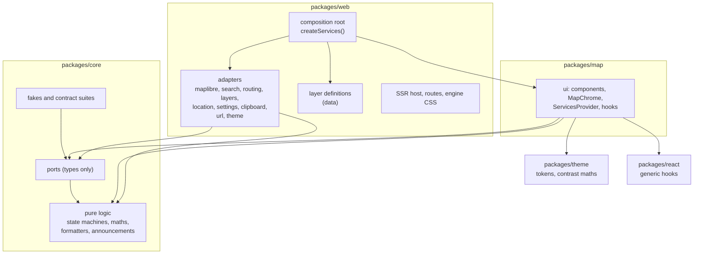

# Architecture

MapCairn separates what the app does from what it runs on. The interface and the pure logic depend on small interfaces (ports). Concrete code that touches a map engine, a browser API or a network service (adapters) lives in one place each and is wired together once, in the composition root.

## Layers and dependency rules

| Layer | Lives in | May import | Must not |
| --- | --- | --- | --- |
| core | `packages/core/src` | itself and npm maths libraries | touch DOM, React, a map engine, a browser global or the clock |
| ports | `packages/core/src/ports` | types from core | contain an implementation (apart from small typed error classes) |
| fakes | `packages/core/src/fakes` | ports, core | read browser globals |
| ui | `packages/map/src` | core, ports, theme, react | import an adapter, an engine or a browser service |
| adapters | `packages/web/src/adapters` | ports, core | be imported by anything except the composition root |
| composition root | `packages/web/src/composition` | everything | be imported as a singleton; it exposes `createServices()` only |

`npm run lint` enforces these rules with dependency-cruiser (layers, engine imports), Biome (restricted imports and globals, accessibility rules) and the harmony scanner in `scripts/harmony` (style, markup and wiring rules), whose rules are proven by Vitest tests in `packages/core/src/lint`. A violation fails the build.

## Ports

Add an interface only where a boundary has at least two implementations. The fake counts as the second implementation. Each port has a real adapter, a fake and a shared contract suite that runs against both.

`MapAdapter` has one real implementation, MapLibre GL JS, and is kept for two reasons. It is the boundary between the ui and the engine, so the ui never imports `maplibre-gl`. It also lets unit tests run the ui against an in-memory fake, with no WebGL. The contract suite runs against the fake and against the real `MapLibreMapAdapter` code, but the adapter there drives a hand-written stand-in for the MapLibre map (`FakeMapLibreMap` in `packages/web/src/adapters/maplibre/maplibreTestEngine.ts`), not `maplibre-gl` itself, because unit tests have no WebGL. The suite keeps the two adapters in step with each other; it does not prove the stand-in matches MapLibre. The end-to-end tests are what exercise the real engine.

| Port | Real adapter | Fake |
| --- | --- | --- |
| `MapAdapter` | MapLibre GL JS (vector and raster styles) | scripted in-memory map |
| `SearchProvider` | Nominatim | scripted results and errors |
| `LocationProvider` | browser geolocation | scripted fixes and errors |
| `SettingsStore` | `localStorage` with in-memory fallback | in-memory |
| `DevicePreferences` | `matchMedia` (reduced motion, fine pointer) and `navigator.connection` (save data, where the browser has it) | scripted values |
| `ClipboardPort` | `navigator.clipboard` with a legacy fallback | recording fake |
| `FileSaver` | `Blob`, an object URL and a download link | recording fake |
| `UrlState` | location hash and `history.replaceState`; `link(value)` builds an address without writing it | in-memory |
| `ThemeSource` | `matchMedia` | scripted system preference |
| `LayerRegistry` | the host's definitions, validated at start-up (`createLayerRegistry`) | `StaticLayerRegistry` over sample definitions |
| `LayerSource` | `FetchLayerSource` (`fetch`, shared response cache) | `FakeLayerSource`, scripted per layer id |
| `RoutingProvider` (optional) | `ValhallaRoutingProvider`, the reference host's one adapter, for a public Valhalla server; the SDK ships none | `FakeRoutingProvider`, scripted routes, areas, errors and delays |

The settings keys are `mapcairn:<name>`.

`BasemapDefinition` is a typed data module, not a port. It is the only place that names a tile source or an attribution string. A `raster` source is a tile URL template and a tile size, and a `vector` source is a style URL. `DEFAULT_BASEMAP_ID` (Bright) is the basemap in both themes when nothing is saved or linked, and an unknown id, including the "auto" of earlier versions, resolves to it. `DEFAULT_BASEMAP_BACKGROUND` is its land colour; the `mapBackground` token carries the same value (a test in `packages/web` keeps them equal), so the server-rendered placeholder and the map host match Bright before it draws. The reference host offers four of the SDK's seven basemaps and one of its own (see below), so there a saved or linked `liberty` opens on the default. The placeholder also holds the decorative `ChromeSkeleton`, so the chrome is in its final place on the first paint.

**Host-supplied basemaps.** The SDK ships only the built-in basemaps (`BASEMAPS`). A host that wants another builds a `BasemapCatalogue` with `createBasemapCatalogue(basemaps, defaultId)` and passes it as the optional `Services.basemaps`; without it the ui offers the built-in catalogue (`BUILT_IN_BASEMAP_CATALOGUE`, Bright the default). The catalogue is plain data with `get(id)` and `resolve(id)`, not a port: it has one shape and no second implementation, so it has no fake and no contract suite, and `portRegistry` lists it under `DATA_SERVICE_NAMES` beside the ports. The picker (`BasemapPicker`), the saved-or-linked choice (`useBasemapChoice`) and the default all read it through `useBasemaps()`, and an id the catalogue does not hold, such as the retired "maptoolkit-dark", resolves to its default. A provider whose licence the host accepts, and that the reusable SDK packages must not carry, is defined in the host and added to a catalogue the host builds. The reference host adds one, Topographic, and it does not offer the whole built-in list either: `packages/web/src/basemaps/hostBasemaps.ts` builds the host's catalogue from a subset of `BASEMAPS` with `getBasemap`, the host's own definition from `packages/web/src/basemaps/openTopoMapBasemap.ts`, and `createBasemapCatalogue` (the same SDK definition objects, none copied), and `createServices()` passes it. It holds Bright (the default), Positron, Streets, Topographic (OpenTopoMap, defined by the host, not the SDK) and Dark (`appearance: "dark"`, a manual choice that never follows the theme), in that order. OpenTopoMap is a volunteer-run server whose terms ask for light use and a note about it, so the SDK does not send every app built on it there; the host takes that on, and its definition imports types only so the thumbnail script can load it. The other four ask for no more than their credit text. Liberty, Colorful and Fiord stay in the SDK for other hosts, and the site makes no request to the VersaTiles server that Colorful uses. A saved or linked id the catalogue does not hold, such as `liberty` or the retired `maptoolkit-dark`, opens on the default. The WebMCP `set-map-basemap` tool offers the basemaps of the host's catalogue (`useBasemaps()`), so it never offers one the picker does not show; a host that adds a basemap with terms to accept must keep it out of that tool, because an agent should not accept a provider's licence on a person's behalf. In the e2e build only, the browser test seam can replace the catalogue, so a spec can run on a host that offers the SDK's whole list.

A definition's `thumbnail` is optional. A basemap without one shows the picker's plain swatch, as Save data does, because the host may not have the right to a preview image.

`RoutingProvider` is the one optional service: `Services.routing` may be absent, and the ui must work without it. `route({ stops, mode, signal })` returns one GeoJSON line feature for each leg with its distance (metres) and duration (seconds), and `reachableArea({ origin, minutes, mode, signal })` returns polygon features. Both reject only with a typed `RoutingError` (`network`, `invalid`, `no-route`, `rate-limited`, `aborted`, `unsupported`).

The reference host's `ValhallaRoutingProvider` (`packages/web/src/adapters/routing`) calls a public Valhalla server with `GET /route` and `GET /isochrone`, decodes the encoded polyline shape itself, maps HTTP and network failures to those kinds, starts at most one request a second through the shared `RequestSpacer`, and sends no cookies or referrer. `packages/map` holds only the generic Directions tool (`tools/Directions`): `useDirections` keeps the stops, mode and result and cancels superseded requests, `DirectionsPanel` is the interface, `MapDirections` draws the result through `setShapeLayer` and fits the map clear of the sheet, and `DirectionsOverlay` draws the lettered stops. None of them names a provider; the host passes the credit and the privacy note, and mounts the button only when `services.routing` exists.

Pure helpers (layer templates, decoders and style evaluation, zoom conversion, metres per pixel, the surface state machine, sheet snapping, coordinate formatting, announcement text, theme resolution, hash parsing) are plain functions in core. They are not wrapped in interfaces.

## The map adapter

MapLibre GL JS is the only map engine, and the ui never imports it. `MapView` takes an adapter factory (`() => MapAdapter`) from the services, mounts one adapter in a host element and wires events to the rest of the ui. Changing basemap calls `setBasemap` on that adapter, with the Save data mode (`useSaveData`: the stored choice, else the device preference), so the adapter can leave out the layers the basemap's `saveDataOmitLayers` lists. It removes those layers, and any source only they use, in its `style.load` handler, before data layers are drawn again, so a Save data change never loses them. It avoids `transformStyle` because a swap with it set waits for the current style, so a failed swap could not put the last basemap back. The adapter builds an inline raster style for a `raster` source and loads the style URL for a `vector` source.

- **Zoom** is normalised to the 256 px tile convention (OpenStreetMap tile numbering). MapLibre counts 512 px tiles, so the engine zoom is the normalised zoom minus one. That offset is one constant, converted only inside the adapter. For the 256 px raster style, the tile level equals the normalised zoom. The URL, the saved view, the scale bar and the tests use the normalised value only.
- **Overlays** (pin, measure line, accuracy circle, the selected feature's ring) are drawn once, in a single overlay layer positioned with `adapter.project` and hidden with `adapter.isVisible` when they are on the far side of a globe. The pin, the measure line, drawn shapes, handles and directions stops are placed through `placePoint` and `placePath` in core (`packages/core/src/globe`), described under Flat or globe.
- **Data layers** are the exception, because hundreds of points or a tiled image belong in the engine. `setFeatureLayer` draws points whose colour, size and shape the ui has already worked out, `setTileLayer` draws raster or WMS tiles (`{bbox-epsg-3857}` is filled by MapLibre) and changes opacity in place, `setShapeLayer` draws an affected area, and `removeLayer` removes any of them. They stack tiles, then shapes, then points, above the basemap, may be set before mount, and are drawn again after every `style.load`, because a full style swap drops them. Points are symbols whose images are rasterised in `markerImages.ts`, so squares and triangles carry meaning beside colour. A tap within a fingertip of a point emits `featureTap` before `click`.
- **Styled shapes, vector tiles and heatmaps.** `setStyledShapes` draws polygons or lines whose look (colour, opacity, hatching, dash and width) the ui has already worked out per shape, and optional label text. `setVectorLayer` draws vector tiles whose features the ui never sees, so the port carries a rule (`fixed`, `category` or `steps` over one property) that the adapter compiles to engine expressions, with a zoom window for the layer and for each source layer. `setHeatmapLayer` draws point density from loaded points or from a vector source layer. Layer windows are normalised zoom, converted inside the adapter; a source's `minzoom` and `maxzoom` are tile levels and are passed through. One data layer owns several engine layers (a fill, a hatching layer, outlines per dash, labels), and the adapter keeps their ids so it erases and orders them as a unit. Hatching is a data-driven `fill-pattern` over images rasterised in `patternImages.ts`; dashes cannot be data-driven, so there is one engine layer per dash style, filtered by value. Labels need glyphs, so they are drawn only when the basemap's style has a glyph source and a literal font stack; a raster basemap has neither, and the list, card and legend carry the words there. Stacking, lowest first: tiles, vector tiles, styled shapes, affected areas, heatmaps, points.
- **Hits and bounds.** `featuresAt(point)` lists every tappable feature under a pixel, topmost first and once each (points and lines within a fingertip, polygons exactly), and `featureTap` carries the topmost one together with that list in `hits`. `getBounds()` is the box the map shows. Vector tile features and heatmaps are not tappable.
- **Image export.** `toImage({ attribution })` returns a PNG blob. The adapter does not set `preserveDrawingBuffer`, which would cost every frame; it repaints, copies the canvas inside the engine's `render` event, where the buffer is valid, draws the credit text along the bottom edge, and encodes it. It requests nothing, and fails with a `MapEngineError` of reason `export-failed` (including a browser that blocks reading the canvas, and a basemap swap that is still loading or starts before the pixels are copied). Overlays the ui draws itself (the pin, the measure line, the selection ring) are not in the image, except marks the caller passes as `drawing` (positions, two hex colours): the adapter places them with the same `placePath` and `placePoint` as the overlay (curves, copy of the world and horizon) and strokes them over the copy with a halo, so drawn shapes are saved as they were seen.
- **Edit handles.** `setEditHandles` gives the adapter the points the person may press and drag (id, position, kind: vertex, midpoint or radius). The ui draws them in the overlay; the adapter only owns the gesture, because only the engine can stop a press from also panning the map. Handles are placed with `placePoint`, as the overlay draws them, so a handle beyond the horizon of a globe cannot be pressed and one just across the antimeridian is pressed where it shows. A press within reach of a handle (12 px for a mouse, 22 px for a finger, the nearest wins, chosen by `pressHandle` in core so both adapters agree) calls `preventDefault` on MapLibre's `mousedown` or one-finger `touchstart`, is reported as `handleDrag` (`start`, then `move` once the pointer leaves the click tolerance, then `end`, with `moved` false for a tap), and its `click` is dropped. `handleHover` reports the handle under a mouse. Handles live on the adapter, not in the style, so they survive a basemap swap, and `MapView` cancels a pending long-press when a press starts on one.
- **Flat or globe.** `Settings.projection` (`"flat"`, the default, or `"globe"`) is the one setting for the map's shape. It reaches the adapter as data: `MapMountOptions.projection` on mount, and `setProjection(projection)` when it changes. The adapter calls the engine's `setProjection` (`mercator` or `globe`) after every `style.load`, so a first mount and every basemap swap keep it, and the app's setting always wins over a style's own `projection` (VersaTiles Colorful asks for a globe). No code branches on a basemap id. Zoom stays the normalised 256 px convention, the address hash is unchanged, and the camera stays north-up with no pitch, so a globe is a different drawing of the same view. `isVisible(latlng)` is the engine's own horizon test (`transform.isLocationOccluded`) and is always true on a flat map; on a globe `project` still returns a pixel for a place on the far side, so every overlay checks `isVisible` and leaves out a pin, vertex or handle beyond the horizon.
  - *Placing marks.* `placePoint` and `placePath` (core, `globe/placement.ts`) take a `MapPlacement` (the shape, the view, `project` and `isVisible`). The engine's `project` places a longitude on the copy of the world it names (190 is one world east of -170) and MapLibre wraps nothing, so a point is drawn on the copy nearest the view centre and every segment of a path goes the short way, across the antimeridian when that is shorter. Positions are only unwrapped for drawing; stored, exported and linked positions keep their own longitudes, and the adapter brings `unproject` and event positions into [-180, 180). A polygon's area is measured with its edges taken the short way too.
  - *Curves.* On a globe each segment is cut along its great circle (`densifyAlongGreatCircles`), the path the measured distance runs along, into pieces short enough to stay within `GLOBE_CHORD_TOLERANCE_PX` (0.5 px) of the arc: a chord of angle θ on a globe of radius R pixels strays at most Rθ²/8, so the step is √(8 · 0.5 / R), with R from `globeRadiusPixels` (MapLibre's `getGlobeRadiusPixels`: 256 · 2^zoom / 2π / cos(centre latitude) in the normalised zoom). That is about 18 degrees at zoom 0, 2.2 at zoom 6 and 0.28 at zoom 12, with at most `MAX_GREAT_CIRCLE_STEPS` (1,024) pieces a segment. A piece that goes over the horizon gains a point where it does (12 halvings), so a line stops at the edge of the disc, and `visibleRuns` splits a path into the parts in sight, wrapping round a ring's closing edge. A closed shape is filled only while all of its outline is in sight. Edge midpoint handles sit on the great circle on a globe (`editHandlesFor(…, projection)`), and picking a shape (`pickShape`) uses the same placement. A flat map draws straight segments, as before. Data layers and the directions route are drawn by the engine and are not curved by the app.
  - *Space around the globe.* MapLibre clears the canvas around the sphere to transparent and draws no atmosphere unless a style has a `sky` (none of the site's do), so the space is the map region's own background. `MapView` renders `data-projection` on the host from its first render, and on a globe the host and the engine container (`mapEngine.css.ts`) take the `mapGlobeSpace` token instead of `mapBackground`; a flat map is unchanged. Before the app mounts, the inline theme script also reads the stored map shape (`PROJECTION_STORAGE_KEY`) and marks the root with `data-map-shape="globe"`, and the server-rendered placeholder takes the same token under that mark, so a globe started in either theme does not flash the pale ground first. The script's hash in `public/_headers` and `constants/securityHeaders.ts` changed with it.
  - *Scale.* MapLibre sizes the globe so a feature at the view centre is as large as on the flat map, so the scale bar, which reads the centre, is the same on both. The sphere has one scale, so on a globe `metresPerPixel(lat)` returns the centre's resolution for any latitude (`mapMetresPerPixel`), which sizes the accuracy circle of a fix away from the centre correctly; between normalised zoom 12 and 13, where the engine blends into the flat map, the two differ by under one percent.
- **Engine CSS** lives in one file, `packages/web/src/adapters/mapEngine.css.ts`. It styles MapLibre only, scopes its rules under the host's `data-map-host` attribute, hides MapLibre's own controls, replaces fonts and focus rings, and sets the map background from the tokens.
- **Loading** is lazy. The MapLibre module imports `maplibre-gl` dynamically the first time the map mounts.
- **User zoom.** The adapter emits `userZoom` only for zoom gestures the engine handles (wheel, pinch, double-click), which MapLibre marks with the input event. `MapView` adds the zoom keys and exposes both as `onUserZoom`, so the app announces the settled level after every zoom the person makes and never after one made in code.
- **Failures.** Tile and source failures are `tileError`, and the map keeps working: one tile error is never fatal. The adapter counts the tiles of the basemap's own sources (any source whose id does not start with `mapcairn:`, so data layers do not count) from the moment its style loads. If some have failed and none has loaded when the map goes idle, it reports `basemapUnavailable` with that basemap (the one whose style loaded, captured then, because the report can come before the mount has resolved: MapLibre fires `load` and the first `idle` in one render), at most once per style load; an expired certificate or a host that is down looks like this. Once any tile of the basemap has loaded, nothing more is reported for that style, because later failures look the same as a patchy connection or a few missing tiles, and leaving a basemap the person can already see would be worse than the general tile error. `MapView` passes the report on as `onBasemapUnavailable(basemap)`, and the host (`useBasemapChoice.unavailableNow`) marks the basemap unavailable for five minutes (`useBasemapAvailability`), goes back to the previous basemap or the default (never one already marked), and says so; with nothing left it stays and only says so. A basemap the person chose in this session was saved when its style loaded, so the choice saved before it is put back; a saved or linked basemap the person did not just choose is not rewritten by an outage, only by going back or dismissing the message, which saves the basemap the map went back to. A source-less error before the pending style document has loaded (`style.load`) is that document failing, and rejects the mount or basemap swap; a sprite or glyph failure comes after it and is a `tileError`. A failed swap puts the last basemap that loaded back, so the map keeps working: `MapView` reports it through `onBasemapError`, not as an engine error, and the app saves a basemap choice only once it has loaded, then shows "That basemap could not be loaded." with "Use previous basemap". A start that fails to load a basemap other than the default (a saved or linked one whose provider is down) falls back the same way: `useMapEngine` mounts again when a different basemap is asked for after such a failure, the host (`useBasemapChoice.mountFailed`) asks for the default and shows the same banner, and going back saves the default so the next start no longer asks for the failed one. A failure of the default itself, or without WebGL, is not about the basemap and keeps its own message. MapLibre reports every worker `error` event with one message, whether the worker never started or threw while running, so after load the adapter waits up to five seconds: if the map goes idle or has everything loaded, it is a `tileError`; otherwise `fatalError` (reason `stopped`), and the app shows "The map stopped working" with Reload, as an alert. A worker error during the first load rejects the mount. A missing WebGL2 context is recognised by MapLibre's exported `GPUInitializationError`.
- **No WebGL** means no map. There is no fallback basemap. The app shows a plain message in place of the map ("MapCairn needs WebGL to draw the map.") with advice to try a different browser or turn on hardware acceleration. `MapUnavailable` draws it inside the map region, so the region and the skip link still work, and announces it once, assertively, through the shared announcer rather than being a live region itself. It has no Retry, because mounting again would fail the same way.

## Data layers

A data layer is typed data: a `LayerDefinition` in `packages/web/src/layers/definitions/`, one file each, collected with `import.meta.glob`. Nothing in the code branches on a layer id, a provider or a response shape.

- **Core** (`packages/core/src/layers`) holds the definition types and a hand-written schema check (`validateLayerDefinition`; core stays free of schema libraries), URL and card templates (`{window}`, `{time|relative}`; the engine's `{z}`, `{x}`, `{y}` and `{bbox-epsg-3857}` are left alone), derived URL variables looked up from control values, filters, a decoder registry with the built-in `geojson` decoder (fields mapped by dotted path, so USGS and GDACS share it), a formatter registry (`relative`, `number`, `km`, `date`), style evaluation with a legend derived from the style, palette slot names, and `SharedResponseCache`, which reuses a response for its `max-age` (or the definition's `cacheSeconds`) and shares a request in flight, so layers split from one feed cost one request.
- **The `LayerSource` port** loads any feed definition with `load({ definition, controls, now, signal })` and an on-request `loadDetail`, and rejects only with a typed `LayerError` (`network`, `invalid`, `empty`, `aborted`). A detail URL comes from the provider's data, so it is requested only when it is `https` on an origin the definition declares.
- **Map** (`packages/map/src/layers`) has `useDataLayers` (state, loading, cancellation, announcements, the permalink value), `MapDataLayers` (draws through the adapter, turns taps into selections), `SelectionMarker`, and the generic `LayersSection`, card and list. The data palette values live in `@mapcairn/theme` (`tokenValues.dataPalette`).
- **Web** registers the definitions and `FetchLayerSource` in `createServices()`. A loop test (`src/layers/layers.test.ts`) checks every definition against the schema, the production CSP, `ATTRIBUTIONS.md` and a recorded fixture, and names what is missing.
- **Layer kinds.** A definition is one of five kinds, which decide what the ui offers: `points`, `shapes`, `heatmap`, `tiles` or `vector`. The guards `isFeedLayer`, `loadsFeatures`, `isHeatmapLayer`, `isVectorTileLayer` and `isShapeStyle` tell them apart, and the ui reads those, not a kind name. A feed layer's `style` is a point style (no `kind`) or a `shapes` style for polygons or lines: a colour rule (`fixed`, `category`, `steps` from explicit class breaks, or `intervals`, equal classes over a numeric field worked out from `min`, `max` and the ramp's length), a pattern, dash and width per class, a fill opacity and a label template. Validation requires a second signal beside colour: a different pattern, width or dash in every class, or a label that names the field. A `heatmap` layer draws a feed or query as density with radius and intensity taken from `range` controls and an opacity control; its legend names each step of the ramp in words. A `vector-tiles` layer has a tile URL, a zoom window for the layer and for each source layer, and a style or heatmap per source layer; its colour rules and label read tile properties by name. Features of a vector tile layer stay in the tiles, so it has a key and no cards or list.
- **Query layers.** A `query` source asks only for the features in view. The URL uses `{west}`, `{south}`, `{east}` and `{north}` (and `{limit}`, one above the cap, so a response shows that more exist). `MapDataLayers` reports the view (`useDataLayers.setView`) when a query layer is turned on and again after the map has been still for 400 ms. `nextQueryWindow` keeps the last window while the view stays inside it and is not much smaller, and otherwise takes a new one snapped to a grid, so small pans send nothing and nearby views share a request. One request is in flight per layer: a new window cancels the old one. The layer keeps what it draws while the next window loads, draws at most `maxFeatures` and says "Showing the first N. Zoom in to see more.", and below its own `minzoom` asks for nothing and says "Zoom in to load this layer." A query layer announces each state once, so a pan to another window is silent.
- **Selection.** A tap that finds several features calls `useDataLayers.choose(hits)`: one opens its card, several open `FeatureChoices`, a list of rows that each open a card, and the card offers "Back to list". The `I` key runs the same route from the centre of the map (`featuresAt`), and says when nothing is there. The open card keeps a snapshot of its feature, so a query layer's card survives a refresh for another part of the map.
- **Controls.** A definition's controls are `segmented`, `switch`, `date` (a UTC day, bounded by fixed days or `{ daysAgo }`), `datetime`, `opacity` and `range`. A `datetime` control is a UTC day and a time on a fixed step (`stepMinutes`, which divides a day), for a product the provider names by timestamp, such as the half-hourly rainfall. Its bounds are fixed slots or `{ minutesAgo }`, counted back from `now` and rounded down to the step, so a `max` set to the provider's latency keeps times that are not out yet off the list. Its value is the slot's start written `YYYY-MM-DDtHHMM` (link-safe), and `templateValues` hands a URL template the ISO instant instead (`2026-11-11T14:30:00Z`). Core gets `now` from the ui's clock (`useDataLayers`), so the newest slot is fixed when the layers mount and never refreshes on a timer. The helpers are in `layers/dateTime.ts`.
- **Permalink.** `UrlStateValue.layers` is written as `#layers=earthquakes,imagery&earthquakes.window=day`, together with the view, so neither drops the other. Values are resolved against the definition when read, so a hand-edited link cannot reach an unknown control or value: a date or a date and time outside its bounds moves to the nearest bound, and a date and time between steps is rounded down to its slot.

## Drawing

The draw tool follows the same split. `packages/core/src/draw` holds a pure reducer over the shapes (point, line, polygon, circle by centre and radius), the selection and a bounded undo stack. It also holds the rules for a valid shape (a line needs two different places, a polygon three that are not on one line and whose edges do not cross or touch, a circle a radius up to 10,000 km), measures that reuse the Measure tool's geodesic maths and unit formatters, the wording of every announcement, the key commands, GeoJSON and CSV text, and the link encoding. Ids come from a counter in the state, so the reducer needs no clock or randomness.

- **State.** `useDraw` (in `packages/map/src/tools/DrawToolbar`) runs the reducer and adds what needs the map and the ports: the map centre and projection for "at map centre", arrow-key nudges and picking a shape by tapping its edge; the announcer; and the file saver and clipboard for export. Shapes belong to the app, not to the toolbar, so they stay on the map when the tool closes. An unfinished shape is dropped when the tool closes, except while the sheet is open over it. Nothing is stored.
- **Surface.** `draw` is a surface like `measure`, so one tool is active at a time. Opening the sheet over a drawing sets `resumeDraw`, and closing the sheet goes back to the draw tool with focus on its Shapes button.
- **Drawing.** Shapes, vertices, midpoint handles, the selection and the dashed preview are drawn in the single SVG overlay (`DrawOverlay`), so they survive a basemap swap with no engine calls. `DrawMapBindings` hands the handles of the selected shape to the adapter and passes its handle events to `useDraw`. A midpoint becomes a new vertex under the pointer for the rest of the drag, and a whole drag, or a run of arrow presses, is one undo step. The overlay is not part of the engine canvas, so an image export of the map has to composite it.
- **Keys.** `MapView` takes an `onKeyCommand` that runs before the map's own keys. The arrows only move a point while one is selected, so they pan the map otherwise.
- **Export.** `shapesToGeoJson` and `shapesToCsv` build the text in core, and the `FileSaver` port offers it as a download. Nothing is sent anywhere.
- **Sharing.** Shapes are never written to the address bar and never stored. "Copy link with shapes" calls `UrlState.link` with the current address state plus `shapes=`, a text of link-safe characters (`A-Z a-z 0-9 . - _`): one letter for the kind, then positions in units of 0.00001 degrees, the first absolute and each later one as a zigzag step, packed five bits to a character, with shapes separated by a full stop. A link is limited to 2,000 characters and 50 shapes, and is refused with a message rather than cut short. Reading a link is bounded and linear in its length, and the next write of the address drops `shapes=`, because only the view, basemap and layers are written.

## Adding an adapter

1. Define or extend the port in `packages/core/src/ports`, with typed errors and an `AbortSignal` on async calls.
2. Write the fake in `packages/core/src/fakes` and the contract suite in `packages/core/src/contracts`.
3. Write the real adapter in `packages/web/src/adapters`, passing the same suite. Helpers that more than one adapter uses (the event emitter, reading media queries) live in `packages/web/src/adapters/shared`.
4. Register it in `createServices()`.
5. Read it in the ui through a typed hook (`useSettings`, `useSearch` and so on).

## How tests substitute services

Unit tests wrap components in `ServicesProvider` with fakes. In non-production builds, `createServices()` accepts overrides from `window.__MAPCAIRN_TEST_SERVICES__`, set with Playwright `addInitScript`, so end-to-end tests script geolocation, search, clipboard, storage and the system theme. Layer providers are answered from the committed fixtures with `page.route` (`e2e/support/layers.ts`), so the e2e tests exercise the real fetch source and decoders. The seam is compiled out of production builds, and a test searches the build output to prove it.
