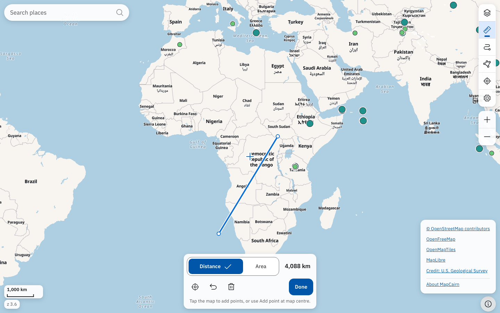
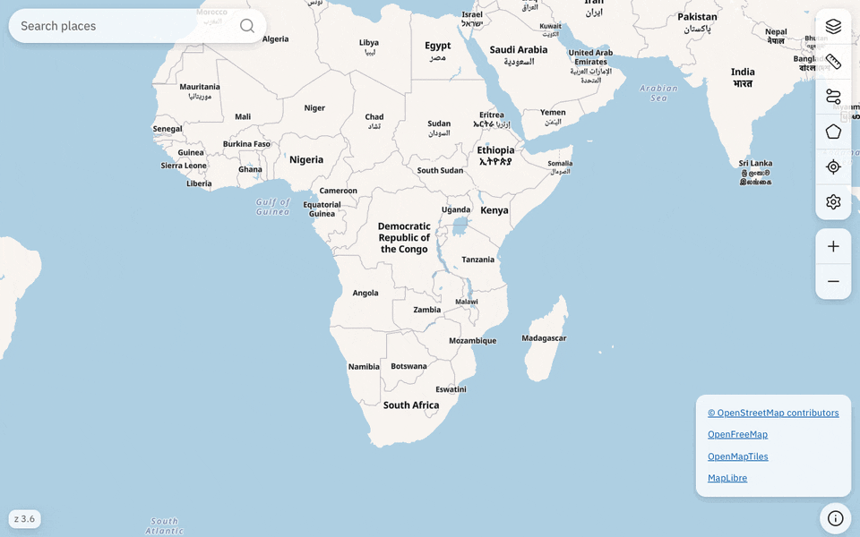

<p>
  <picture>
    <source media="(prefers-color-scheme: dark)" srcset="docs/brand/logo-mark-dark.svg">
    
  </picture>
</p>

# MapCairn

[](https://github.com/MapCairn/mapcairn/actions/workflows/ci.yml)
[](LICENSE)
[](https://www.bestpractices.dev/projects/16543)
[](https://scorecard.dev/viewer/?uri=github.com/MapCairn/mapcairn)

**MapCairn is an open-source React SDK for maps that serve the public.** It is for teams building public-interest map applications, such as open data and hazard maps, who would rather spend their time on the data than on the interface around it. MapCairn supplies that interface on top of MapLibre GL JS: search, measuring and drawing tools, a layers panel and a design system, built to be accessible and private. Open data layers are written as data, and every service the map talks to sits behind a small interface, so it can be replaced or faked in a test.

This repository also holds the playground, a reference site built from the SDK's packages.

<p>
  <picture>
    <source media="(prefers-color-scheme: dark)" srcset="docs/images/playground-dark.png">
    
  </picture>
</p>

The playground in its light and dark themes, with the earthquakes layer on and a distance measured. Map data and tile credits are in [`ATTRIBUTIONS.md`](ATTRIBUTIONS.md).

**Status:** the SDK is usable from this repository, but the packages are not on npm yet. Publishing them is part of the First release milestone in [`ROADMAP.md`](ROADMAP.md), and [`docs/guides/releasing.md`](docs/guides/releasing.md) describes how a release is made.

## Try the playground

The playground at [mapcairn.timothybrits.co.za/map](https://mapcairn.timothybrits.co.za/map) is a complete map built from the SDK's packages, and it is where the SDK is shown working and where its browser tests run. Search for a place, measure a distance or draw a shape, turn on an open data layer such as earthquakes or rainfall, switch the interface between English and Afrikaans in Settings, and open Help to find the About block that links back here. The recording below searches for a place, turns on the earthquakes layer for the past week, measures a distance and opens the map credits.

<p>
  <picture>
    <source media="(prefers-color-scheme: dark)" srcset="docs/images/playground-demo-dark.gif">
    
  </picture>
</p>

## Embed a map

One package holds the whole SDK, with one stylesheet and two import paths: the interface from the root, and the MapLibre adapter that draws the map from a subpath. React is a peer dependency and `maplibre-gl` is a required peer, because the adapter needs the engine, so a strict package manager wants both listed:

```bash
npm install @mapcairn/sdk@next react react-dom maplibre-gl
```

```ts
import "@mapcairn/sdk/styles.css";
import { MapChrome, ServicesProvider } from "@mapcairn/sdk";
```

The packages are not on npm yet (see Status above), so the install works once they are. `@mapcairn/sdk` re-exports `core`, `map`, `react` and `theme` from its root, and the MapLibre adapter at `@mapcairn/sdk/adapter-maplibre`. Its stylesheet is the three the packages ship, in order: tokens, the map's, the engine's. An app that wants less installs the packages it needs: `core` has no React or browser dependency, and `theme` installs without the interface. [`packages/sdk/README.md`](packages/sdk/README.md) lists the entry points and says how to keep one copy of a package when you also list it directly.

A real map needs the adapter in the services, and the adapter needs the URL of the engine's worker file. In a Vite app that is the bundler's own worker URL import:

```ts
import { createFakeServices } from "@mapcairn/sdk";
import { createMapLibreMapAdapter } from "@mapcairn/sdk/adapter-maplibre";

const services = createFakeServices({
  createMapAdapter: () =>
    createMapLibreMapAdapter({
      loadWorkerUrl: async () => {
        const worker = await import(
          "maplibre-gl/dist/maplibre-gl-worker.mjs?worker&url"
        );
        return worker.default;
      },
    }),
});
```

Give `services` to `ServicesProvider`, as the whole-app example below does. The other ports stay on the fakes until you write an adapter for each one you need. Another bundler must serve `maplibre-gl/dist/maplibre-gl-worker.mjs` as a same-origin file and resolve `loadWorkerUrl` to its address; [`docs/guides/content-security-policy.md`](docs/guides/content-security-policy.md) covers the `worker-src` that file needs.

The adapter makes no request until a map mounts, and then asks only for what the basemap you pass `MapView` names: it has no default basemap and no origin of its own. The basemaps in `@mapcairn/core`, including the default the example below resolves, name a public tile provider, so choose the one whose terms and privacy you accept. A test checks the block above against the SDK's source declarations through the `@mapcairn/source` condition. The release's consumer check, which covers the packed packages, has a browser leg that builds an app listing only `@mapcairn/sdk` with plain Vite and draws the map in Chromium under a strict policy with a mocked style; it runs in the `SDK packages` job, which is not a required check, and the release `check` job does not draw a map. Plain Vite and Chromium only: other bundlers and browsers have not been tried here. [`docs/guides/extending.md`](docs/guides/extending.md#show-a-real-map) holds the details, including what to do when a server bundle imports the subpath, and [`packages/adapter-maplibre/README.md`](packages/adapter-maplibre/README.md) lists what the adapter asks of a host. The whole-app example below and `examples/embed` stay on the fakes.

This is a whole app. It mounts the map with the SDK's interface around it and a search box at the top, written against the four packages, which is what the playground and `examples/embed` use. Every name in it comes from `@mapcairn/sdk` too, so with the umbrella you change the imports and drop the second stylesheet:

```tsx
import "@mapcairn/theme/tokens.css";
import "@mapcairn/map/styles.css";
import { createFakeServices } from "@mapcairn/core";
import {
  FocusRegistryProvider,
  LiveRegionProvider,
  MapChrome,
  MapView,
  SearchPill,
  ServicesProvider,
  TooltipProvider,
  useBasemaps,
  useMap,
} from "@mapcairn/map";
import { type ReactNode, useState } from "react";

export function App() {
  const [services] = useState(createFakeServices);
  return (
    <ServicesProvider services={services}>
      <LiveRegionProvider>
        <TooltipProvider>
          <MapScreen />
        </TooltipProvider>
      </LiveRegionProvider>
    </ServicesProvider>
  );
}

function MapScreen() {
  const basemaps = useBasemaps();
  return (
    <MapView
      initialView={{
        center: { lat: -33.92, lng: 18.42 },
        zoom: 11,
        bearing: 0,
      }}
      basemap={basemaps.resolve(basemaps.defaultId)}
      chrome={(background) => <Chrome background={background} />}
    />
  );
}

function Chrome({ background }: { readonly background: ReactNode }) {
  const map = useMap();
  return (
    <FocusRegistryProvider focusMap={map.focusMap}>
      <MapChrome
        background={background}
        modal={false}
        topStart={
          <SearchPill
            onSelect={(result) =>
              map.adapter?.setView({ center: result.centre, zoom: 14 })
            }
          />
        }
      />
    </FocusRegistryProvider>
  );
}
```

`createFakeServices()` runs the interface on the SDK's in-memory fakes, so the app above requests nothing and draws no map tiles. With the real adapter from the block above in its services, it draws the default basemap from that basemap's public provider.

[`examples/embed`](examples/embed/README.md) is the full version of this app, written against the four packages directly, with the end stack of controls, the sheet, the measure tool, layers and a search provider of its own, and a test in `packages/core/src/lint/readme.test.ts` fails if this snippet uses an import, a component or a prop that the example does not (an import from `@mapcairn/sdk` counts as the package it re-exports). [`docs/guides/extending.md`](docs/guides/extending.md) lists what an app provides around it (the stylesheet import, base styles and the font). The snippet sets no page styles: the SDK ships no base stylesheet today, so an app gives the page a height, removes the body margin and sets its own font and colours (the example does it in `examples/embed/src/main.tsx` and `page.css`). Whether the SDK should ship base styles or stable alias properties for theming is not decided.

The SDK does not depend on the playground's framework. The playground is a server-rendered React 19 app on React Router, Vite and Cloudflare Workers, but the SDK packages import neither React Router nor MapLibre, the two that use React (`map` and `react`) take it as a peer, and `examples/embed` is a plain Vite and React app. The SDK's styles are compiled to plain stylesheets, so it needs no vanilla-extract plugin and should render in any React 19 app whose bundler handles a CSS import, though no other framework has been tried here. There is no prebuilt bundle for pages without React yet. [`docs/guides/serving-from-iis.md`](docs/guides/serving-from-iis.md) covers serving a build you make yourself from IIS and a server-rendered page; it was checked against Microsoft's documentation and not run on a Windows server.

## What the SDK adds to a map renderer

**A finished interface.** Search with optional suggestions as you type, zoom and compass controls, a bottom sheet that becomes a side panel on wide screens, measuring, drawing and editing shapes with GeoJSON, CSV and WKT import and export, directions through your own routing provider, a layers panel with keys, feature cards, saving the map as an image, and links that carry the view, the basemap, the layers and drawn shapes.

**Layers as data.** A layer is one definition: a feed, raster or vector tiles, a heatmap, or a query for what is in view. The SDK draws it, builds its key, card and list, keeps words beside every colour, and validates the definition. A host can list its layers or load them at runtime, and a runtime definition that fails validation is left out with the reasons. See [A layer is data](#a-layer-is-data) below.

**Accessibility.** WCAG 2.2 AA is the target in both themes, every gesture has a keyboard or single-tap equivalent, announcements go through one live region, and the layout mirrors for right-to-left languages.

**Privacy.** Apart from the basemap, nothing is requested until a person asks: a layer loads when it is turned on, a search when it is submitted, an address or a route when one is asked for. The exception is search suggestions, which a host may turn on and which send the text typed so far. The SDK has no accounts and no tracking, and the panels that say what is sent to a provider take the host's own wording, with neutral defaults that name no provider.

**Ports and fakes.** The interface never imports MapLibre or an adapter, and reaches a browser service only through a port. Search, suggestions, routing, geolocation, storage, the clipboard, URL state, layers and the map engine are small interfaces (ports), each with an in-memory fake and a shared contract suite. You can test the whole interface without WebGL or a network, and check your own adapter against the same suite as the fake.

**A design system.** Typed tokens only, light and dark themes, one accent, IBM Plex Sans and Lucide icons. The contrast of every token pair is calculated in a test, and a style scanner rejects raw colours, off-scale spacing and unnamed controls.

**Translation.** The interface's text is looked up by key in a message catalogue, so a host can translate or replace it, in a language written left to right or right to left. A host can also translate its layer templates, unit symbols, coordinate words and its own definition labels. The SDK sets the page direction from the language tag, formats numbers, lists and days for the language, reads coordinates typed with other digits, isolates coordinates and names inside right-to-left text, and adjusts type tracking and line height for non-Latin scripts. The SDK ships British English and the reference site offers Afrikaans; a host supplies its own catalogue for any other language, and a font for a script IBM Plex Sans does not cover. Settings offers a choice when a host offers more than one language. The [translation guide](docs/guides/translate-the-sdk.md) says what the SDK supplies, what a host supplies and what is not covered.

**Server rendering.** The map host, chrome, sheet and readout are tested to render no style attributes on the server, so a server-rendered page can keep a Content Security Policy with no `unsafe-inline`. The playground renders its page and a placeholder of the chrome on the server and hydrates; the map itself is drawn in the browser. The [Content Security Policy guide](docs/guides/content-security-policy.md) lists what a host page needs.

**Pure, tested logic.** Geometry, measurement, formatting, URL state and the surface state machine are plain functions with no DOM, and the readers of untrusted text (WKT, shape files, coordinates and share links) have property-based tests.

## A layer is data

This is a whole raster tile layer. The key, the opacity control, the credit and the privacy and Content Security Policy checks come from it.

```ts
import type { TileLayerDefinition } from "@mapcairn/core";

const example: TileLayerDefinition = {
  id: "example-overlay",
  name: "Example overlay",
  description: "What the overlay shows, in one sentence.",
  group: "Imagery",
  dataCost: "about 100 KB per screen",
  attribution: [{ text: "Example provider", url: "https://example.org/" }],
  controls: [{ kind: "opacity", id: "opacity", label: "Opacity", default: 0.8 }],
  source: {
    kind: "tiles",
    tiles: "https://tiles.example.org/{z}/{x}/{y}.png",
    tileSize: 256,
    maxzoom: 12,
  },
};

export default example;
```

Feeds, polygons and lines with patterns, heatmaps, vector tiles and queries for what is in view work the same way: see [`docs/guides/extending.md`](docs/guides/extending.md). [`docs/guides/serving-layers.md`](docs/guides/serving-layers.md) has worked layers for OGC API Features, WMS and WMTS services.

## When MapCairn fits, and when it does not

It fits a team that:

- builds in React and wants a complete, accessible map interface rather than a blank canvas;
- shows open data from providers the browser can reach directly, and wants each layer requested only when a person turns it on;
- wants to test its map interface without a browser or WebGL, against fakes;
- can publish its source under AGPL-3.0, or will discuss other terms (see [Licence](#licence)).

It is not the right choice today if you need:

- a hosted service, a dataset or accounts. MapCairn is code: you choose each provider (tiles, search, routing) and its terms, and you host the app;
- GIS analysis. MapCairn is not a GIS analysis engine: it measures, draws and has geometry helpers, but does no overlay analysis or geoprocessing;
- a map engine other than MapLibre GL JS, or tilt, terrain and 3D buildings;
- to `npm install` it, to mount it in a page without React, or to reach layers behind a login;
- your own colours and font with contrast checked, clustering of dense points or offline use.

A map renderer on its own leaves every interface decision to you, which is the better choice when your interface has little in common with a map application. The [capability matrix](docs/guides/capability-matrix.md) lists what MapCairn has, partly has and lacks, with the issue for each gap that has one, and [`ROADMAP.md`](ROADMAP.md) says what comes next.

## Quick start

You need Node 24 or newer and npm 11 or newer.

```bash
git clone https://github.com/MapCairn/mapcairn.git
cd mapcairn
npm install
npm run dev
```

`npm run dev` serves the playground on port 5173. `npm run dev -w @mapcairn/example-embed` runs the example app instead. [`CONTRIBUTING.md`](CONTRIBUTING.md) lists the checks.

## How it is checked

- **The playground** is built from the SDK packages and is what the browser tests run against, on desktop and mobile Chromium, with the basemap, keyboard, sheet and app-shell tests also on iPhone WebKit and in a right-to-left layout.
- **The example app** imports the SDK by package name only. It is type-checked, built and tested on every pull request, so a missing export or build step fails CI.
- **Coverage floors:** `npm run test:coverage` fails below 95% of statements, branches, functions and lines across the SDK packages.
- **Contract suites:** each port has one suite, run against its fake and, where the playground has one, its real adapter, so they cannot drift apart.
- **Accessibility:** automated axe checks for WCAG 2.0 A and AA and WCAG 2.1 and 2.2 AA run in the required `e2e` check on every pull request.
- **Security and licences:** CodeQL, a secret scan, OpenSSF Scorecard, and a lint check that every production dependency of an SDK package has a permissive licence.

## Packages

| Package                                                             | Provides                                                                                                      |
| ------------------------------------------------------------------- | ------------------------------------------------------------------------------------------------------------- |
| [`@mapcairn/sdk`](packages/sdk/README.md)                           | The packages below from one install and one import, with one stylesheet. It holds no code of its own          |
| [`@mapcairn/core`](packages/core/README.md)                         | The port interfaces, pure logic, basemap definitions, fakes and contract suites. No React, no browser globals |
| [`@mapcairn/map`](packages/map/README.md)                           | The map interface: chrome, sheet and panels, tools, `MapView` and the services provider                       |
| [`@mapcairn/react`](packages/react/README.md)                       | Generic React hooks                                                                                           |
| [`@mapcairn/theme`](packages/theme/README.md)                       | The typed design tokens and their contrast calculations                                                       |
| [`@mapcairn/adapter-maplibre`](packages/adapter-maplibre/README.md) | The MapLibre GL JS map adapter and its engine styles. `maplibre-gl` is a peer dependency                      |

`packages/web` is the playground, called the reference host in the rest of the documentation.

## Documentation

| Document                                                                             | Covers                                                                                                     |
| ------------------------------------------------------------------------------------ | ---------------------------------------------------------------------------------------------------------- |
| [`ARCHITECTURE.md`](ARCHITECTURE.md)                                                 | Layers, ports and adapters, the map adapter, adding an adapter                                             |
| [`DESIGN.md`](DESIGN.md)                                                             | Tokens, layout slots, accessibility contracts and the lint rules                                           |
| [`docs/guides/public-api.md`](docs/guides/public-api.md)                             | What counts as the SDK's public API beyond its exports, the API reports and how a change is classed        |
| [`docs/guides/extending.md`](docs/guides/extending.md)                               | Embedding the SDK, and adding a basemap, each kind of data layer, a search or routing provider, an adapter |
| [`docs/guides/translate-the-sdk.md`](docs/guides/translate-the-sdk.md)               | Another language, a choice of languages, translating definitions, your own message-format library          |
| [`docs/guides/serving-layers.md`](docs/guides/serving-layers.md)                     | Which layer kind to serve from your own server, what each costs, and OGC API Features, WMS and WMTS layers |
| [`docs/guides/content-security-policy.md`](docs/guides/content-security-policy.md)   | The Content Security Policy a page hosting the SDK needs, and why                                          |
| [`docs/guides/serving-from-iis.md`](docs/guides/serving-from-iis.md)                 | Serving a build of the SDK from IIS and from a server-rendered page such as a Razor page                   |
| [`docs/guides/using-the-reference-site.md`](docs/guides/using-the-reference-site.md) | Using the playground: search, saving the map, choosing between features, drawing, import and export        |
| [`docs/guides/capability-matrix.md`](docs/guides/capability-matrix.md)               | What a GIS application needs, what MapCairn has, partly has or lacks, and the issue for each gap           |
| [`docs/guides/performance.md`](docs/guides/performance.md)                           | What was measured for Lighthouse, what was tried and what was left alone                                   |
| [`docs/guides/working-with-agents.md`](docs/guides/working-with-agents.md)           | Using a coding agent on this repository: what each one reads and how to start                              |
| [`docs/guides/personal-preferences.md`](docs/guides/personal-preferences.md)         | Keeping your own working style for a coding agent in a git-ignored file, not in the shared rules           |
| [`docs/plans/`](docs/plans/README.md)                                                | Numbered plans for work not yet built                                                                      |
| [`GOVERNANCE.md`](GOVERNANCE.md)                                                     | The maintainer role, how decisions are made, and what is not yet covered                                   |
| [`ROADMAP.md`](ROADMAP.md)                                                           | What the project intends to do in the next twelve months, and what it will not do                          |
| [`docs/assurance-case.md`](docs/assurance-case.md)                                   | Security requirements, trust boundaries, threat model and the evidence for each                            |
| [`AGENTS.md`](AGENTS.md)                                                             | Working rules for people and AI changing the code                                                          |

## Contributing, security and conduct

See [`CONTRIBUTING.md`](CONTRIBUTING.md) for checks and conventions, [`GOVERNANCE.md`](GOVERNANCE.md) for who decides what, [`ROADMAP.md`](ROADMAP.md) for what is planned and what is not, [`SECURITY.md`](SECURITY.md) for private vulnerability reporting (with the [assurance case](docs/assurance-case.md)) and [`CODE_OF_CONDUCT.md`](CODE_OF_CONDUCT.md) for community expectations.

Everyone is welcome to use the coding agent they prefer, and the same rules in [`AGENTS.md`](AGENTS.md) apply to all of them. [`docs/guides/working-with-agents.md`](docs/guides/working-with-agents.md) lists what Claude Code, Codex, OpenCode, GitHub Copilot, Antigravity, Cursor and Qwen Code read, as checked against their documentation, how to start, and what has not been tried.

## Licence

MapCairn is licensed under [AGPL-3.0](LICENSE), and each SDK package (`packages/core`, `packages/map`, `packages/react`, `packages/theme`, `packages/adapter-maplibre` and `packages/sdk`) carries its own copy. If you ship the SDK in a product, or let people use a modified version over a network, you must publish the corresponding source under the same licence.

The SDK packages depend only on permissively licensed packages (MIT, BSD, Apache-2.0, ISC and similar), and `npm run lint` fails when a new production dependency of one has any other licence.

The author welcomes conversations about other terms for closed-source use. A commercial licence is not on offer yet, and any that is agreed would go towards the continued development of MapCairn. Contact the author at [mapcairn@timothybrits.co.za](mailto:mapcairn@timothybrits.co.za).

See [`ATTRIBUTIONS.md`](ATTRIBUTIONS.md) for software and basemap credits and [`PRIVACY.md`](PRIVACY.md) for the privacy policy.
